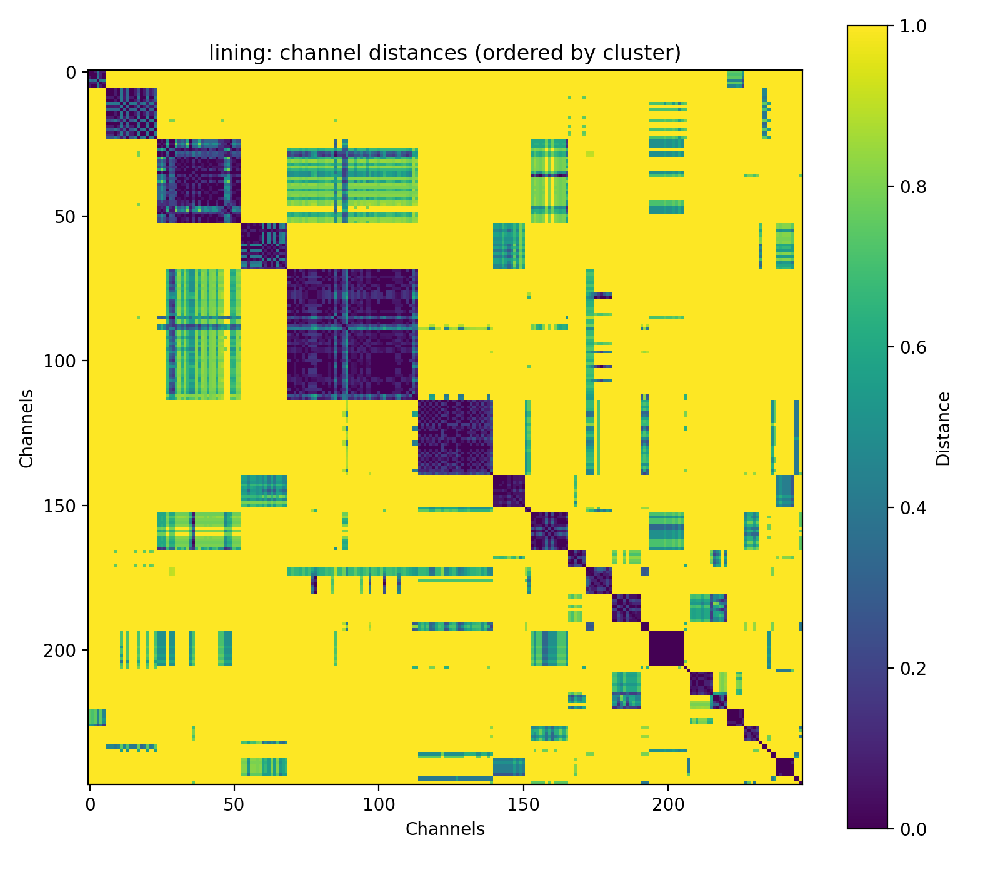
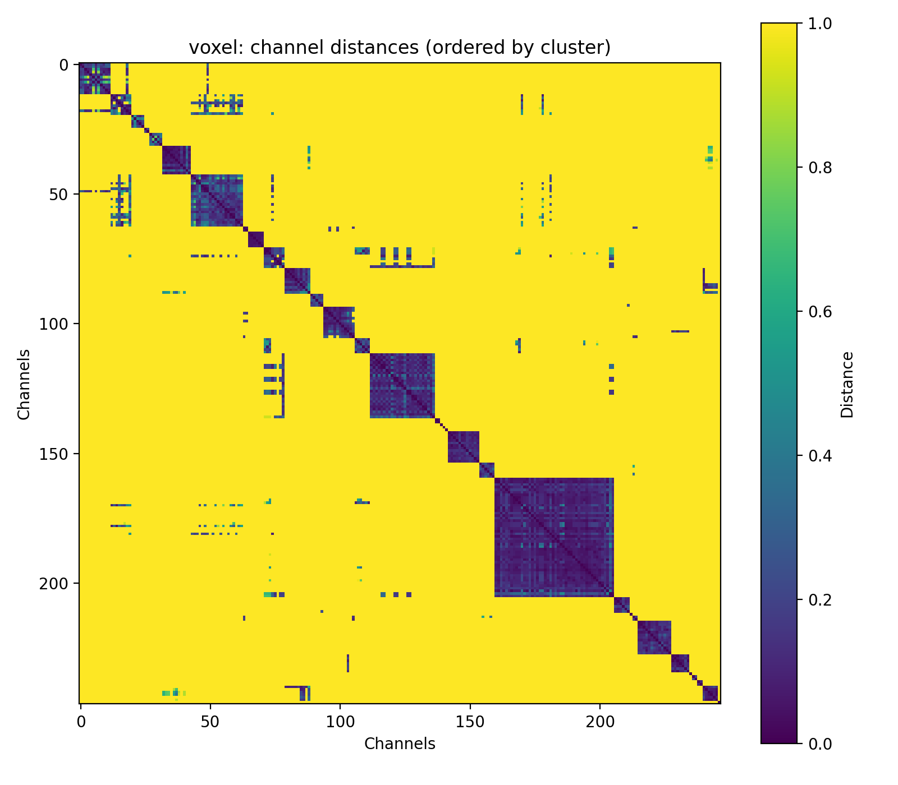
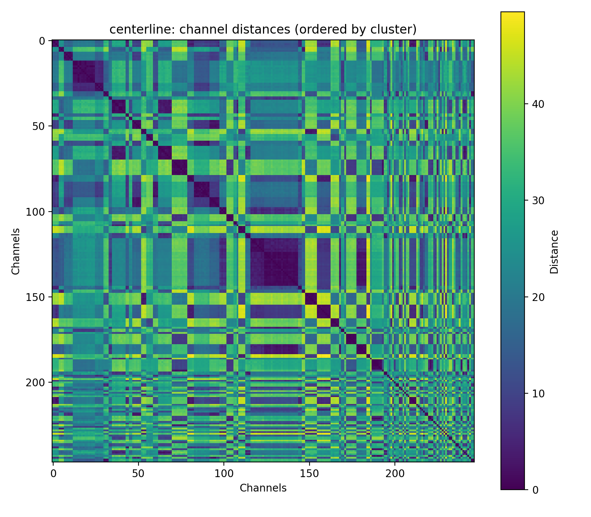
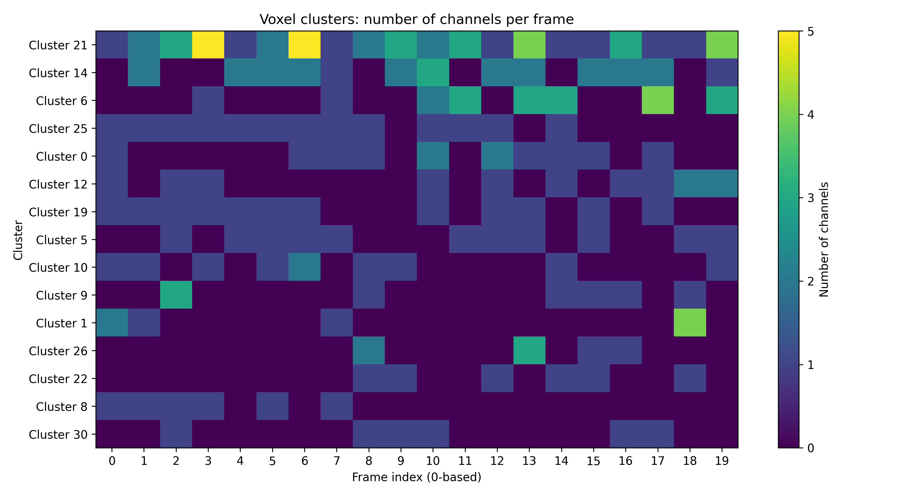
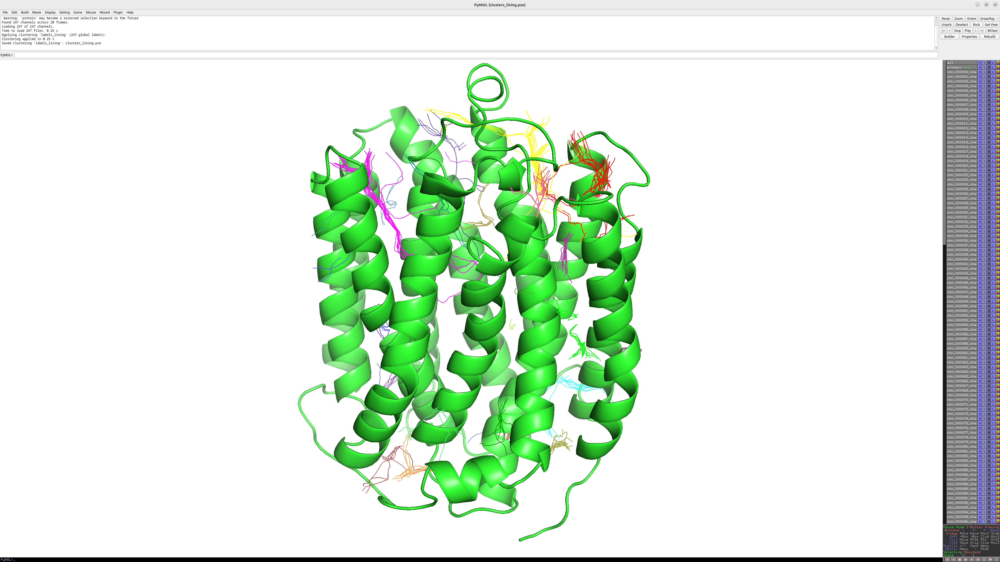
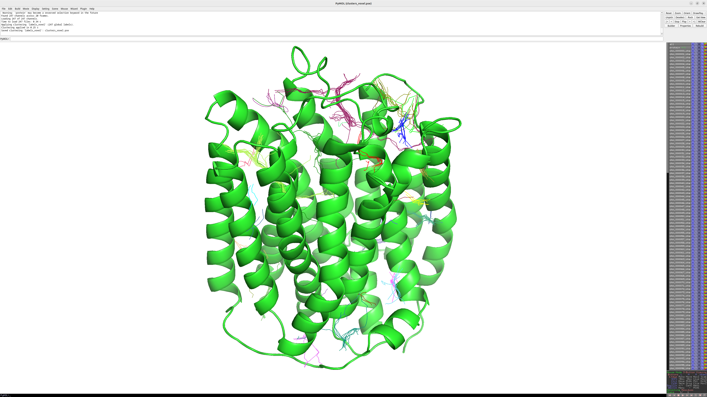
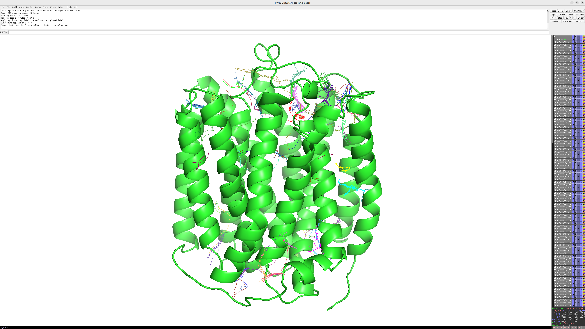
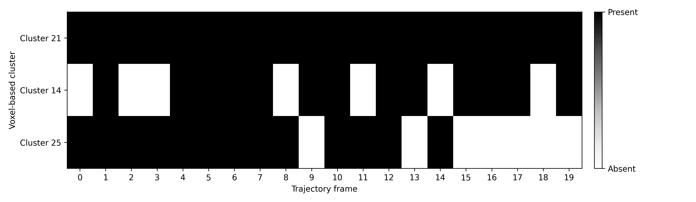

.. _cavitracer_clustering:

Clustering of channels detected in MD trajectories
===============================================================================

CaviTracer can identify multiple channels in individual structures or in
consecutive frames of a molecular dynamics trajectory. The number,
position, and geometry of these channels may change between conformations.
Since channels are detected independently in each frame, their indices do not
necessarily refer to the same pathway throughout the trajectory. Clustering
allows us to group channels according to their similarity and examine which
channel families are repeatedly observed.

In this tutorial, we will compare three approaches: (1) similarity of the 
residues lining the channels, (2) overlap between their voxelized volumes, 
and (3) similarity of their centerline geometry. We will also compare the 
resulting cluster assignments and visualize them in PyMOL.

We will use the MD trajectory of the vesicular monoamine transporter VMAT2
(``caseStudy2.pdb`` and ``caseStudy2.dcd``), described in the CaviTracer
trajectory tutorial. The system contains 460 protein residues. Although the
trajectory contains 211 frames, only the first 20 frames are analyzed here 
to keep the example relatively short.

I. Channel detection
===============================================================================

First, we load the PDB structure and the corresponding trajectory using
:func:`.parsePDB` and :class:`.Trajectory`. The DCD is linked to the complete
PDB structure, whereas the analysis itself is restricted to protein atoms.

.. ipython:: python
   :verbatim:

   from prody import *
   import numpy as np
   from pathlib import Path

   atoms = parsePDB('caseStudy2.pdb')
   dcd = Trajectory('caseStudy2.dcd')
   dcd.link(atoms)
   dcd.setCoords(atoms)
   protein = atoms.select('protein')
   dcd.setAtoms(protein)

.. parsed-literal::

   @> 56457 atoms and 1 coordinate set(s) were parsed in 0.64s.

Next, channels are detected using :func:`.calcChannelsMultipleFrames`.
``start_frame=0`` and ``stop_frame=19`` select 20 frames, because the final
frame index is inclusive. Setting ``separate=True`` writes every identified
channel to a separate PQR file. We use two processors for the calculation and
save the results in a dedicated directory.

.. ipython:: python
   :verbatim:

   output = Path('caseStudy2_analysis')
   (output / 'channels').mkdir(parents=True, exist_ok=True)

   channels, surfaces = calcChannelsMultipleFrames(
       protein, dcd, output_path=str(output / 'channels'),
       separate=True, max_proc=2, mp_context='fork',
       inner_radius=0.9, min_depth=5, output_format='pqr',
       start_frame=0, stop_frame=19)

.. parsed-literal::

   @> The atoms supplied to calcChannels contain protein atoms only.
   @> The atoms supplied to calcChannels contain protein atoms only.
   @> Substituted 5986 atoms with 77434 homogeneous balls of radius 1.20 Å in 0.29s.
   @> Substituted 5986 atoms with 77434 homogeneous balls of radius 1.20 Å in 0.30s.
   @> Delaunay tessellation of 77434 points constructed in 3.58s.
   @> Delaunay tessellation of 77434 points constructed in 3.72s.
   @> Surface and inner simplices filtered in 3.70s.
   @> Surface and inner simplices filtered in 3.67s.
   @> Cavities: 343 found, 13 deeper than min_depth=5.0 Å and searched for channels, in 0.73s.
   @> Chambers (probe 1.40 Å): 5 of the 13 searched cavities have them; the other 12 are searched whole.
   @>     cavity 0: 11 chambers, 4 of them seeded.
   @>     cavity 1: 5 chambers, none of them deep and large enough to seed; searched whole.
   @>     cavity 2: 2 chambers, none of them deep and large enough to seed; searched whole.
   @>     cavity 6: 1 chamber, none of them deep and large enough to seed; searched whole.
   @>     cavity 8: 1 chamber, none of them deep and large enough to seed; searched whole.
   @> 16 search sites (sp) in 0.05s: one per seeded chamber, one per cavity searched whole.
   @> Cavities: 348 found, 12 deeper than min_depth=5.0 Å and searched for channels, in 0.75s.
   @> Chambers (probe 1.40 Å): 4 of the 12 searched cavities have them; the other 10 are searched whole.
   @>     cavity 0: 12 chambers, 5 of them seeded.
   @>     cavity 1: 7 chambers, 1 of them seeded.
   @>     cavity 2: 1 chamber, none of them deep and large enough to seed; searched whole.
   @>     cavity 6: 1 chamber, none of them deep and large enough to seed; searched whole.
   @> 16 search sites (sp) in 0.05s: one per seeded chamber, one per cavity searched whole.
   @> Channel search (Dijkstra) over 16 search sites in 13 cavities completed in 0.37s.
   @> Found 12 channels and 4 links (a link joins a deep chamber to a shallower one and never reaches the surface).
   @> Search sites (sp), the void each search ran from, largest first; sp<n> tags every channel, link and output file:
   @>     site  start_point [Å]             void                   volume [ų]  depth [Å]  channels  links
   @>     sp0   [3.032, 3.513, 1.501]       cavity 0, chamber 1/4         1449       17.9         -      2  -> sp11, sp12
   @>     sp1   [-10.001, -0.851, -15.276]  cavity 1, whole               1278        8.4         -      -  sealed
   @>     sp2   [10.032, 8.304, -13.543]    cavity 2, whole                952        8.0         1      -
   @>     sp3   [0.765, -14.660, -12.894]   cavity 3, whole                406        8.2         1      -
   @>     sp4   [9.686, -12.095, -12.610]   cavity 4, whole                376        6.0         1      -
   @>     sp5   [2.172, -0.305, 16.746]     cavity 5, whole                333       21.2         -      -  sealed
   @>     sp6   [13.140, 10.727, 15.087]    cavity 6, whole                206        7.7         1      -
   @>     sp7   [12.534, -6.892, 15.844]    cavity 7, whole                185        6.8         -      -  sealed
   @>     sp8   [6.534, 1.294, -19.704]     cavity 8, whole                156        5.3         1      -
   @>     sp9   [14.460, -4.672, 12.934]    cavity 9, whole                103        5.2         1      -
   @>     sp10  [16.272, -2.383, -3.473]    cavity 10, whole                99        5.1         1      -
   @>     sp11  [6.810, 3.705, 8.722]       cavity 0, chamber 2/4           99       11.8         -      1  -> sp12
   @>     sp12  [5.872, 8.973, 12.107]      cavity 0, chamber 3/4           92        5.9         5      -
   @>     sp13  [-3.834, -6.232, 14.871]    cavity 11, whole                70        5.4         -      -  sealed
   @>     sp14  [-8.575, -3.805, 5.480]     cavity 0, chamber 4/4           69       31.1         -      1  -> sp0
   @>     sp15  [1.582, 3.182, -21.791]     cavity 12, whole                55        5.5         -      -  sealed
   @>     (site volumes measure the void itself and are not on the swept-sphere scale of the channel volumes)
   @> The 5 sites marked sealed above report neither a channel nor a link: no route out of them survived - either narrower than bottleneck=0.90 Å, or dropped as a duplicate of a shallower site's, or the void is its own mouth and has nowhere to path to. Lower bottleneck to see how the first kind connect.
   @> Saving 12 channels and 4 links to directory caseStudy2_analysis/channels, one file per object named sp<site>_chl<n> and sp<site>_lnk<n>.
   @> Channel calculation completed in 8.72s.
   @> The atoms supplied to calcChannels contain protein atoms only.
   @> Channel search (Dijkstra) over 16 search sites in 12 cavities completed in 0.39s.
   @> Found 10 channels and 3 links (a link joins a deep chamber to a shallower one and never reaches the surface).
   @> Search sites (sp), the void each search ran from, largest first; sp<n> tags every channel, link and output file:
   @>     site  start_point [Å]             void                   volume [ų]  depth [Å]  channels  links
   @>     sp0   [0.849, 1.755, 4.232]       cavity 0, chamber 1/5         1390       17.7         -      1  -> sp10
   @>     sp1   [10.366, 8.517, -13.767]    cavity 2, whole                836        7.6         1      -
   @>     sp2   [14.036, 1.166, 14.265]     cavity 3, whole                484        5.9         2      -
   @>     sp3   [11.877, -11.633, -12.403]  cavity 4, whole                248        6.2         1      -
   @>     sp4   [3.814, -2.945, 17.876]     cavity 5, whole                233       13.7         -      -  sealed
   @>     sp5   [11.547, 9.837, 17.633]     cavity 6, whole                179        5.5         -      -  sealed
   @>     sp6   [14.908, 1.397, -1.071]     cavity 7, whole                157        8.6         1      -
   @>     sp7   [10.673, -5.202, 15.935]    cavity 8, whole                154        5.0         1      -
   @>     sp8   [6.459, 1.999, -19.681]     cavity 9, whole                126        5.0         1      -
   @>     sp9   [14.694, -2.890, 13.269]    cavity 10, whole               116        5.3         1      -
   @>     sp10  [5.789, 8.884, 11.904]      cavity 0, chamber 2/5          110        6.8         1      -
   @>     sp11  [-12.974, 5.142, -11.283]   cavity 11, whole               100        5.4         -      -  sealed
   @>     sp12  [-12.619, 4.302, 11.770]    cavity 0, chamber 3/5           67        7.7         -      -  sealed
   @>     sp13  [-8.411, -3.935, 5.404]     cavity 0, chamber 4/5           63       15.0         -      1  -> sp0
   @>     sp14  [6.642, 3.825, 8.825]       cavity 0, chamber 5/5           59       12.7         -      1  -> sp10
   @>     sp15  [4.818, -11.587, -19.483]   cavity 1, chamber 1/1           52        8.3         1      -
   @>     (site volumes measure the void itself and are not on the swept-sphere scale of the channel volumes)
   @> The 4 sites marked sealed above report neither a channel nor a link: no route out of them survived - either narrower than bottleneck=0.90 Å, or dropped as a duplicate of a shallower site's, or the void is its own mouth and has nowhere to path to. Lower bottleneck to see how the first kind connect.
   @> Saving 10 channels and 3 links to directory caseStudy2_analysis/channels, one file per object named sp<site>_chl<n> and sp<site>_lnk<n>.
   @> Channel calculation completed in 8.89s.
   ..
   ..
   @> Channel calculation completed in 8.43s.
   @> The atoms supplied to calcChannels contain protein atoms only.
   @> Substituted 5986 atoms with 77434 homogeneous balls of radius 1.20 Å in 0.28s.
   @> Delaunay tessellation of 77434 points constructed in 3.32s.
   @> Surface and inner simplices filtered in 3.04s.
   @> Cavities: 360 found, 7 deeper than min_depth=5.0 Å and searched for channels, in 0.68s.
   @> Chambers (probe 1.40 Å): 4 of the 7 searched cavities have them; the other 5 are searched whole.
   @>     cavity 0: 19 chambers, 5 of them seeded.
   @>     cavity 1: 2 chambers, 1 of them seeded.
   @>     cavity 2: 3 chambers, none of them deep and large enough to seed; searched whole.
   @>     cavity 4: 1 chamber, none of them deep and large enough to seed; searched whole.
   @> 11 search sites (sp) in 0.04s: one per seeded chamber, one per cavity searched whole.
   @> Channel search (Dijkstra) over 11 search sites in 7 cavities completed in 0.42s.
   @> Found 11 channels and 2 links (a link joins a deep chamber to a shallower one and never reaches the surface).
   @> Search sites (sp), the void each search ran from, largest first; sp<n> tags every channel, link and output file:
   @>     site  start_point [Å]            void                   volume [ų]  depth [Å]  channels  links
   @>     sp0   [2.794, 3.210, 2.878]      cavity 0, chamber 1/5         1175       17.3         1      1  -> sp4
   @>     sp1   [11.029, 9.449, -14.676]   cavity 2, whole                451        9.5         -      -  sealed
   @>     sp2   [3.319, -4.179, 14.473]    cavity 3, whole                305       14.7         -      -  sealed
   @>     sp3   [14.549, -2.949, -17.464]  cavity 4, whole                233        6.3         1      -
   @>     sp4   [5.428, 9.703, 12.525]     cavity 0, chamber 2/5          219        5.8         1      -
   @>     sp5   [4.971, -12.019, -19.237]  cavity 0, chamber 3/5          106        6.8         2      -
   @>     sp6   [13.011, 2.236, 15.324]    cavity 1, chamber 1/1           88        5.4         4      -
   @>     sp7   [8.805, -5.043, 0.725]     cavity 5, whole                 87        5.5         1      -
   @>     sp8   [6.437, -7.548, 14.803]    cavity 6, whole                 72        5.1         -      -  sealed
   @>     sp9   [-3.897, -0.702, 11.624]   cavity 0, chamber 4/5           69       25.7         -      1  -> sp0
   @>     sp10  [-11.926, -3.534, -7.477]  cavity 0, chamber 5/5           52       16.9         1      -
   @>     (site volumes measure the void itself and are not on the swept-sphere scale of the channel volumes)
   @> The 3 sites marked sealed above report neither a channel nor a link: no route out of them survived - either narrower than bottleneck=0.90 Å, or dropped as a duplicate of a shallower site's, or the void is its own mouth and has nowhere to path to. Lower bottleneck to see how the first kind connect.
   @> Saving 11 channels and 2 links to directory caseStudy2_analysis/channels, one file per object named sp<site>_chl<n> and sp<site>_lnk<n>.
   @> Channel calculation completed in 7.78s.
   @> The atoms supplied to calcChannels contain protein atoms only.
   @> Substituted 5986 atoms with 77434 homogeneous balls of radius 1.20 Å in 0.27s.
   @> Delaunay tessellation of 77434 points constructed in 3.20s.
   @> Surface and inner simplices filtered in 2.90s.
   @> Cavities: 353 found, 8 deeper than min_depth=5.0 Å and searched for channels, in 0.76s.
   @> Chambers (probe 1.40 Å): 5 of the 8 searched cavities have them; the other 5 are searched whole.
   @>     cavity 0: 21 chambers, 7 of them seeded.
   @>     cavity 1: 2 chambers, 1 of them seeded.
   @>     cavity 2: 1 chamber, none of them deep and large enough to seed; searched whole.
   @>     cavity 3: 1 chamber, seeded.
   @>     cavity 4: 1 chamber, none of them deep and large enough to seed; searched whole.
   @> 14 search sites (sp) in 0.06s: one per seeded chamber, one per cavity searched whole.
   @> Channel search (Dijkstra) over 14 search sites in 8 cavities completed in 0.53s.
   @> Found 13 channels and 2 links (a link joins a deep chamber to a shallower one and never reaches the surface).
   @> Search sites (sp), the void each search ran from, largest first; sp<n> tags every channel, link and output file:
   @>     site  start_point [Å]              void                   volume [ų]  depth [Å]  channels  links
   @>     sp0   [2.954, 2.403, 1.063]        cavity 0, chamber 1/7         1208       16.1         2      -
   @>     sp1   [14.270, -3.396, 11.348]     cavity 2, whole                359        7.3         -      -  sealed
   @>     sp2   [14.637, -1.867, -18.146]    cavity 4, whole                306        5.0         1      -
   @>     sp3   [0.682, -1.666, -6.439]      cavity 0, chamber 2/7          206       24.3         -      1  -> sp0
   @>     sp4   [11.540, -12.369, -12.046]   cavity 5, whole                167        5.1         1      -
   @>     sp5   [5.275, 10.584, -11.015]     cavity 6, whole                108        5.1         -      -  sealed
   @>     sp6   [4.841, -11.919, -20.561]    cavity 0, chamber 3/7           91        8.0         2      -
   @>     sp7   [11.055, 9.011, -13.452]     cavity 3, chamber 1/1           88       12.8         1      -
   @>     sp8   [-11.736, -3.221, -6.607]    cavity 0, chamber 4/7           85       19.2         -      -  sealed
   @>     sp9   [-4.079, -1.650, 12.015]     cavity 0, chamber 5/7           83        9.8         1      1  -> sp0
   @>     sp10  [-11.505, -10.640, -20.588]  cavity 7, whole                 79        5.0         -      -  sealed
   @>     sp11  [13.458, 9.716, 14.927]      cavity 1, chamber 1/1           75        7.7         3      -
   @>     sp12  [-13.629, 2.669, 9.842]      cavity 0, chamber 6/7           55       10.9         -      -  sealed
   @>     sp13  [4.674, 9.090, 13.423]       cavity 0, chamber 7/7           51        5.2         2      -
   @>     (site volumes measure the void itself and are not on the swept-sphere scale of the channel volumes)
   @> The 5 sites marked sealed above report neither a channel nor a link: no route out of them survived - either narrower than bottleneck=0.90 Å, or dropped as a duplicate of a shallower site's, or the void is its own mouth and has nowhere to path to. Lower bottleneck to see how the first kind connect.
   @> Saving 13 channels and 2 links to directory caseStudy2_analysis/channels, one file per object named sp<site>_chl<n> and sp<site>_lnk<n>.
   @> Channel calculation completed in 7.70s.
   @> Wrote the PyMOL trajectory viewer caseStudy2_analysis/channels/vis_channels_traj.py. 
      View the output with `pymol vis_channels_traj.py -- "channels*_sp*_chl*.pqr" [protein.pdb]`.

Each item in ``channels`` is a list of channels detected in one trajectory
frame. We can examine how many channels were found in each frame:

.. ipython:: python
   :verbatim:

   print('Analyzed frames:', len(channels))
   print('Channels per frame:', [len(ch) for ch in channels])
   print('Total channels:', sum(len(ch) for ch in channels))

.. parsed-literal::

   Analyzed frames: 20
   Channels per frame: [10, 9, 14, 12, 8, 12, 16, 12, 13, 10, 17, 8, 13, 17, 12, 11, 12, 17, 11, 13]
   Total channels: 247

Thus, the 20 analyzed frames contain 247 detected channel instances. In the
following steps, each instance is compared with all other instances,
including those originating from different trajectory frames.

II. Calculating distances between channels
===============================================================================

CaviTracer provides several ways to compare channels. The functions below
return both a pairwise distance matrix and the corresponding channel records.
Records preserve the original frame index (``conformation_id``) and the
association between a channel and its calculated descriptors. In each
matrix, rows and columns correspond to the same 247 channels, ordered by
frame and then by channel index within that frame.

Channel-lining residues
-------------------------------------------------------------------------------

The :func:`.buildLiningSequenceDistanceMatrix` function identifies residues
lining each channel and calculates pairwise distances between the resulting
residue sets. This approach compares the local protein environment rather
than the precise path or volume of a channel. The ``alpha`` parameter adjusts
the weighting of the differences between residue sets in the Tversky-based
metric.

.. ipython:: python
   :verbatim:

   D_lining, records_lining = buildLiningSequenceDistanceMatrix(protein, 
	channels=channels, trajectory=dcd, alpha=1.0, start_frame=0, stop_frame=19)

.. parsed-literal::

   @> Frame: 0
   @> Frame: 1
   @> Frame: 2
   @> Frame: 3
   @> Frame: 4
   @> Frame: 5
   @> Frame: 6
   @> Frame: 7
   @> Frame: 8
   @> Frame: 9
   @> Frame: 10
   @> Frame: 11
   @> Frame: 12
   @> Frame: 13
   @> Frame: 14
   @> Frame: 15
   @> Frame: 16
   @> Frame: 17
   @> Frame: 18
   @> Frame: 19

Voxel overlap
-------------------------------------------------------------------------------

The :func:`.buildVoxelOverlapDistanceMatrix` function first represents
channels as occupied voxels on a shared three-dimensional grid. It then
compares pairs of channels according to the overlap between their volumes.
Here, ``voxel_size=0.5`` defines the grid resolution in Å, while ``beta``
controls the weighting of the non-overlapping regions. A value of zero
indicates identical occupied regions, whereas a value close to one indicates
little or no overlap.

.. ipython:: python
   :verbatim:

   D_voxel, records_voxel = buildVoxelOverlapDistanceMatrix(channels=channels, 
		voxel_size=0.5, beta=0.3, max_proc=2, mp_context='fork')

.. parsed-literal::

   @> All Bounding Boxes Built
   @> All Channels Voxelized
   @> All Channel Overlap Counts Computed

Channel centerlines
-------------------------------------------------------------------------------

The :func:`.buildCenterlineDistanceMatrix` function compares the geometric
paths followed by channel centerlines. Unlike the two previous metrics,
centerline distances in this example are not restricted to the interval
between zero and one. We disable radius normalization and distance clipping
using ``normalize_radii=False`` and ``clip_distance=False``.

.. ipython:: python
   :verbatim:

   D_centerline, records_centerline = buildCenterlineDistanceMatrix(channels=channels, 
	     max_proc=2, mp_context='fork', normalize_radii=False, clip_distance=False)

We can verify that all three matrices describe the same number of channels:

.. ipython:: python
   :verbatim:

   print('Lining distance matrix:', D_lining.shape)
   print('Voxel distance matrix:', D_voxel.shape)
   print('Centerline distance matrix:', D_centerline.shape)

.. parsed-literal::

   Lining distance matrix: (247, 247)
   Voxel distance matrix: (247, 247)
   Centerline distance matrix: (247, 247)

III. Clustering channels using the distance matrices
===============================================================================

Next, we use :func:`.clusterChannels` to identify groups of similar channels.
The function supports hierarchical agglomerative clustering, DBSCAN, and
HDBSCAN. In this example, we use agglomerative clustering with average
linkage and a distance threshold for defining individual clusters.

Since the three distance metrics have different numerical scales and
properties, their thresholds are chosen independently. They should not be
compared as if they were equivalent physical distances.

.. ipython:: python
   :verbatim:

   labels_lining, clustering_lining = clusterChannels(D_lining, 
	method='agglomerative', records=records_lining, linkage='average', 
	distance_threshold=0.4)

.. ipython:: python
   :verbatim:

   array([ 4,  8, 13, 24, 11,  2,  2,  3,  9,  1,  4, 24, 13,  4,  2,  3,  1,
           5,  5,  6,  4,  4, 13, 24, 15,  4, 11, 17,  1,  3, 10, 10, 10,  4,
          24, 13,  1,  9,  3, 11,  2,  4,  4,  4,  2,  4,  6, 13, 21, 23,  1,
           5,  5,  6,  4,  4, 13, 24,  0, 22,  1,  3,  1,  5,  5,  6,  4,  4,
          13,  3,  1,  1,  8, 25,  3,  4, 19,  5,  5,  4,  2,  4,  6,  5, 10,
          10,  8, 19, 24,  2,  1, 21,  2, 16,  4,  8,  3,  1, 18,  0, 16,  1,
           9,  3,  4,  4,  4,  3,  4,  0, 18, 19,  4,  3,  5,  5,  4, 11,  3,
          10,  8, 13, 10, 10, 10,  2,  4,  1,  8,  5,  2,  5,  5,  6,  4,  2,
           1,  4,  4,  2,  2,  4, 20,  8,  6,  1, 11, 13,  1, 18,  8, 19,  5,
           5, 16,  4, 13,  8,  4,  6, 17,  4, 23,  2,  5, 16,  2, 16,  2,  5,
           4,  4,  8,  0,  2,  3,  2, 18, 11,  1,  2,  9, 12,  4,  6, 16,  8,
          18, 13, 19,  0,  5,  5, 12,  4, 16, 11,  1,  4,  9,  3,  4,  5,  5,
          12,  7,  4,  8, 13,  2,  3,  2, 17, 17, 26, 25, 11,  5,  2,  0,  5,
           2,  7,  4,  2, 11,  6, 14,  2,  8,  2, 16, 18,  5,  6,  4,  4, 11,
           2,  2,  4,  2,  9,  4, 17,  3,  5])

The ``labels_lining`` array contains the cluster assignments for all 247 
channels identified across 20 trajectory frames. Each element corresponds 
to one channel, and its value indicates the cluster to which that channel 
belongs. In this example, 27 clusters were identified, numbered from 0 to 26.

To display how many channels belong to each cluster, we can:

.. ipython:: python
   :verbatim:

   import numpy as np
   cluster_ids, counts = np.unique(labels_lining, return_counts=True)

   for cluster_id, count in zip(cluster_ids, counts):
      print('Cluster {}: {} channels'.format(cluster_id, count))

.. parsed-literal::

   Cluster 0: 6 channels
   Cluster 1: 18 channels
   Cluster 2: 29 channels
   Cluster 3: 16 channels
   Cluster 4: 45 channels
   Cluster 5: 26 channels
   Cluster 6: 11 channels
   Cluster 7: 2 channels
   Cluster 8: 13 channels
   Cluster 9: 6 channels
   Cluster 10: 9 channels
   Cluster 11: 10 channels
   Cluster 12: 3 channels
   Cluster 13: 12 channels
   Cluster 14: 1 channels
   Cluster 15: 1 channels
   Cluster 16: 8 channels
   Cluster 17: 5 channels
   Cluster 18: 6 channels
   Cluster 19: 5 channels
   Cluster 20: 1 channels
   Cluster 21: 2 channels
   Cluster 22: 1 channels
   Cluster 23: 2 channels
   Cluster 24: 6 channels
   Cluster 25: 2 channels
   Cluster 26: 1 channels

.. ipython:: python
   :verbatim:

   labels_voxel, clustering_voxel = clusterChannels(D_voxel, 
	method='agglomerative', records=records_voxel, linkage='average', 
	distance_threshold=0.55)

   labels_centerline, clustering_centerline = clusterChannels(D_centerline, 
	method='agglomerative', records=records_centerline, linkage='average', 
	distance_threshold=2.2)

The ``labels`` arrays contain one cluster identifier per channel. The
``clustering`` objects provide access to the identified :class:`.Cluster`
objects and their statistics. We can inspect how many clusters were found:

.. ipython:: python
   :verbatim:

   print('Lining clusters:', len(clustering_lining.clusters))
   print('Voxel clusters:', len(clustering_voxel.clusters))
   print('Centerline clusters:', len(clustering_centerline.clusters))

.. parsed-literal::

   Lining clusters: 27
   Voxel clusters: 32
   Centerline clusters: 84

These numbers show that the selected metric and distance threshold affect
how the detected channels are grouped. In this example, the centerline-based
approach divides the channels into a larger number of clusters than the
lining-residue and voxel-overlap approaches.

Visualizing the distance matrices
-------------------------------------------------------------------------------

The distance matrices can be displayed as heatmaps. To make the clustering
patterns easier to inspect, rows and columns are ordered according to their
cluster labels.

.. ipython:: python
   :verbatim:

   import matplotlib.pyplot as plt

   for name, D, labels in [('lining', D_lining, labels_lining),
                           ('voxel', D_voxel, labels_voxel),
                           ('centerline', D_centerline, labels_centerline)]:
       order = np.argsort(labels, kind='stable')
       plt.figure(figsize=(8, 7))
       plt.imshow(D[np.ix_(order, order)], interpolation='nearest')
       plt.title(name + ': channel distances (ordered by cluster)')
       plt.xlabel('Channels')
       plt.ylabel('Channels')
       plt.colorbar(label='Distance')
       plt.tight_layout()
       plt.savefig(str(output / ('distance_' + name + '.png')), dpi=200)
       plt.close()

The figures below show the distance matrices obtained in this example.
Low-distance regions appear near the diagonal after the channels have been
reordered by their cluster assignments.

   Pairwise channel distances based on the sets of channel-lining residues.
   The 247 channels are ordered according to their lining-based cluster labels.

   Pairwise channel distances based on the overlap of voxelized channel
   volumes. The 247 channels are ordered according to their voxel-based
   cluster labels.

   Pairwise distances based on channel-centerline geometry. The 247 channels
   are ordered according to their centerline-based cluster labels.

IV. Comparing clustering results
===============================================================================

The three approaches may group the same channels differently. To quantify
how similar two cluster assignments are, we use :func:`.compareClusterings`.
It calculates the adjusted Rand index (ARI) and adjusted mutual information
(AMI). Values closer to one indicate higher agreement; values near zero
indicate agreement comparable to chance under the corresponding adjustment.

.. ipython:: python
   :verbatim:

   print('Lining vs voxel:', compareClusterings(labels_lining, labels_voxel))
   print('Centerline vs voxel:', compareClusterings(labels_centerline, labels_voxel))

.. parsed-literal::

   Lining vs voxel: {'ARI': 0.861186901893276, 'AMI': 0.8983745631507167}
   Centerline vs voxel: {'ARI': 0.44505338544835726, 'AMI': 0.6891605110380669}

For these settings, the residue-lining and voxel-based classifications show
higher agreement than the centerline and voxel-based classifications.
However, this comparison alone does not establish which metric is most
appropriate for a particular biological question.

V. Persistence of channel clusters across trajectory frames
===============================================================================

In addition to identifying similar channels, we can determine how often a
cluster is observed across the analyzed trajectory. For a given cluster,
*persistence* is the number of distinct frames containing at least one of
its channels, divided by the number of analyzed frames. It therefore differs
from the total number of channel instances in the cluster: several channels
from the same frame can belong to one cluster.

For example, :meth:`.Cluster.calcPersistence` calculates this quantity for
a selected cluster:

.. ipython:: python
   :verbatim:

   selected = clustering_voxel.getClusterByLabel(21)
   print('Cluster:', selected.label)
   print('Channels:', selected.size)
   print('Frames:', len(set(selected.conformation_ids)))
   print('Persistence:', selected.calcPersistence(len(channels)))

.. parsed-literal::

   Cluster: 21
   Channels: 46
   Frames: 20
   Persistence: 1.0

This voxel-based cluster contains 46 channel instances, with at least one
instance observed in each of the 20 frames. Cluster identifiers are labels
assigned by the clustering algorithm and need not remain identical after
changing clustering parameters or software versions.

To save the same information for all clusters and all three methods, we can
write a tab-separated summary file:

.. ipython:: python
   :verbatim:

   clusterings = [('lining', clustering_lining),
                  ('voxel', clustering_voxel),
                  ('centerline', clustering_centerline)]

   with open(str(output / 'cluster_summary.tsv'), 'w') as handle:
       handle.write('method\tcluster\tchannels\tframes\tpersistence\n')
       for method, clustering in clusterings:
           for cluster in clustering.clusters:
               persistence = cluster.calcPersistence(len(channels))
               n_frames = len(set(cluster.conformation_ids))
               handle.write('{}\t{}\t{}\t{}\t{:.4f}\n'.format(
                   method, cluster.label, cluster.size, n_frames, persistence))

.. parsed-literal::

   method  cluster  channels  frames  persistence
   lining  4        45        20      1.0000
   voxel   21       46        20      1.0000
   centerline  26   20        20      1.0000

The lines above are selected examples from ``cluster_summary.tsv``, not the
complete file.

The distribution of channels among clusters can also be examined for each
frame. The following figure shows the number of channel instances assigned
to the most populated voxel-based clusters in each of the 20 frames.

.. ipython:: python
   :verbatim:

   import numpy as np
   import matplotlib.pyplot as plt
   from pathlib import Path

   frame_ids = np.repeat(np.arange(len(channels)), [len(c) for c in channels])
   cluster_ids, counts = np.unique(labels_voxel, return_counts=True)
   top_clusters = cluster_ids[np.argsort(counts)[::-1][:15]]
   data = np.zeros((len(top_clusters), len(channels)))

   for i, cluster_id in enumerate(top_clusters):
       for frame in range(len(channels)):
           data[i, frame] = np.sum((labels_voxel == cluster_id) & (frame_ids == frame))

   plt.figure(figsize=(11, 6))
   plt.imshow(data, aspect='auto', interpolation='nearest', cmap='viridis')
   plt.yticks(range(len(top_clusters)), ['Cluster {}'.format(i) for i in top_clusters])
   plt.xticks(range(len(channels)))
   plt.xlabel('Frame index (0-based)')
   plt.ylabel('Cluster')
   plt.title('Voxel clusters: number of channels per frame')
   plt.colorbar(label='Number of channels')
   plt.tight_layout()
   plt.savefig('voxel_clusters_frames.png', dpi=300)

   Number of channel instances assigned to selected voxel-overlap clusters
   across the 20 analyzed trajectory frames.

VI. Saving cluster assignments and visualizing them in PyMOL and VMD
===============================================================================

Visualization in PyMOL
-------------------------------------------------------------------------------

The :func:`.writeClusterLabels` function saves clustering assignments in a
text file. Importantly, the rows must retain the same order as the channel
records: frames in ascending order, followed by channels in their original
within-frame order. This order is also used by the PyMOL visualization script.

.. ipython:: python
   :verbatim:

   writeClusterLabels(str(output / 'labels_lining.tsv'), labels_lining)
   writeClusterLabels(str(output / 'labels_voxel.tsv'), labels_voxel)
   writeClusterLabels(str(output / 'labels_centerline.tsv'), labels_centerline)
   writeClusterLabels(str(output / 'cluster_labels.tsv'),
                      [labels_lining, labels_voxel, labels_centerline],
                      names=['lining', 'voxel', 'centerline'])

.. parsed-literal::

   'caseStudy2_analysis/cluster_labels.tsv'

To visualize the results, :func:`.writePyMolMultiModelScript` generates the
protein structure and a PyMOL script. We set ``flat=True`` so that individual
channel instances remain separate objects and can be colored according to
their externally calculated cluster labels.

.. ipython:: python
   :verbatim:

   writePyMolMultiModelScript(protein, output_path=str(output), flat=True)

.. parsed-literal::

   @> CaviTracer PyMOL files written:
   @>     protein: caseStudy2_analysis/protein.pdb
   @>     PyMOL script: caseStudy2_analysis/vis_channels_traj_flat.py
   @> View the result from caseStudy2_analysis with: pymol vis_channels_traj_flat.py -- protein.pdb

   ('caseStudy2_analysis/protein.pdb',
    'caseStudy2_analysis/vis_channels_traj_flat.py')

The output directory now contains ``protein.pdb`` and ``vis_channels_traj_flat.py`` 
along with the label files. The generated PQR files are located in the ``channels`` 
subdirectory. We can open the three clusterings in PyMOL from the Bash terminal:

.. code-block:: console

   $ cd caseStudy2_analysis
   $ pymol vis_channels_traj_flat.py -- "channels/channels*_sp*_chl*.pqr" --protein-file protein.pdb --labels labels_lining.tsv --out-file clusters_lining.pse
   $ pymol vis_channels_traj_flat.py -- "channels/channels*_sp*_chl*.pqr" --protein-file protein.pdb --labels labels_voxel.tsv --out-file clusters_voxel.pse
   $ pymol vis_channels_traj_flat.py -- "channels/channels*_sp*_chl*.pqr" --protein-file protein.pdb --labels labels_centerline.tsv --out-file clusters_centerline.pse

Each command creates a PyMOL session (``.pse``) in which channels belonging
to the same cluster receive the same color. The sessions can be reopened
without repeating the clustering calculation. The images below show the
three cluster assignments for the VMAT2 structure.

   PyMOL representation of the VMAT2 structure and channels colored by their
   lining-residue cluster assignments.

   PyMOL representation of the VMAT2 structure and channels colored by their
   voxel-overlap cluster assignments.

   PyMOL representation of the VMAT2 structure and channels colored by their
   centerline-based cluster assignments.

The PQR files, TSV tables, PyMOL sessions, and distance plots provide
complementary representations of the same analysis. In particular, the
cluster assignments allow the same channel family to be followed across
frames even when its local channel index changes.

Visualization in VMD
-------------------------------------------------------------------------------

The clustering results can also be visualized in VMD using
:func:`.writeVmdClusterScript`. Unlike the standard multi-frame visualization,
which displays channels from one trajectory frame at a time, this function
allows channels from different frames to be displayed simultaneously and
colored according to their cluster assignments.

First, we combine the PQR files generated for individual trajectory frames
into a single multi-model PQR file using :func:`.mergeFramesPQR`:

.. ipython:: python
   :verbatim:

   mergeFramesPQR(str(output / 'channels'),
                  str(output / 'channels_frames.pqr'),
                  prefix='channels', frames=range(len(channels)))

Next, we generate a VMD script for the voxel-overlap clustering results.
For clarity, we select three clusters containing relatively large numbers
of channel instances: clusters 21, 14, and 25.

.. ipython:: python
   :verbatim:

   _, _, tcl_file = writeVmdClusterScript(
       str(output / 'channels_frames.pqr'), protein, labels_voxel,
       output_path=str(output / 'vmd_voxel'),
       selected_clusters=[21, 14, 25],
       representation='Licorice', view='overlay')

The ``view='overlay'`` option displays all channels belonging to the selected
clusters simultaneously, regardless of the trajectory frame in which they
were detected. Channels assigned to the same cluster receive the same color,
allowing their spatial distribution and geometric variability to be examined.

In this example, cluster 21 contains 46 channel instances, cluster 14
contains 25, and cluster 25 contains 13. They are displayed in blue, red,
and green, respectively, while the protein is shown as a silver cartoon.
The colors are assigned according to the order specified in
``selected_clusters``.

The generated visualization can be opened in VMD from the Bash terminal:

.. code-block:: console

   $ cd caseStudy2_analysis/vmd_voxel
   $ vmd -e vis_channels_frames.tcl

The ``Licorice`` representation displays channel centerlines as thin
cylinders, making it easier to distinguish overlapping pathways. Other
representations, including ``Lines``, ``VDW``, ``CPK``, and ``QuickSurf``,
are also available. For example, to display the same clusters as lines:

.. ipython:: python
   :verbatim:

   _, _, tcl_file = writeVmdClusterScript(str(output / 'channels_frames.pqr'), 
		protein, labels_voxel, output_path=str(output / 'vmd_voxel_lines'),
       		selected_clusters=[21, 14, 25],
       		representation='Lines', view='overlay')

Alternatively, setting ``view='frames'`` displays channels from one
trajectory frame at a time while preserving their cluster colors across
frames. This representation can be useful for examining how the occurrence
of particular channel families changes between conformations.

Both visualization modes use the same clustering assignments. The
``overlay`` view is particularly useful for comparing the geometries of
channels assigned to the same cluster, whereas the ``frames`` view allows
their distribution across individual conformations to be inspected.

VII. Assessing clustering stability
===============================================================================

The :func:`.computeBootstrapStability` function can be used to examine how
sensitive the cluster assignments are to subsampling. For a trajectory,
``sampling='frame'`` is useful because entire conformations, rather than
individual channels, are selected in each replicate. In this example, 80%
of the frames are randomly selected in each of 50 replicates, and the
resulting assignments are compared with the clustering obtained using all
20 frames.

.. ipython:: python
   :verbatim:

   stability = computeBootstrapStability(
       D_voxel, method='agglomerative', records=records_voxel,
       sampling='frame', sub_size=0.8, n_bootstrap=50,
       random_state=123, linkage='average', distance_threshold=0.55)

   print('Mean bootstrap ARI:', np.mean(stability['scores']))

.. parsed-literal::

   Mean bootstrap ARI: 0.9806513111664771

The adjusted Rand index (ARI) measures the agreement between cluster
assignments. A value of 1 indicates identical clustering, whereas values
close to 0 indicate agreement comparable to random assignments. The mean
ARI of 0.981 indicates that the voxel-based clustering is highly stable
under the selected frame-subsampling procedure.

Persistence and stability of selected channel clusters
-------------------------------------------------------------------------------

Clustering can also help us identify channel families that are repeatedly
observed during a trajectory. To select clusters for further analysis,
we first rank them according to their persistence, defined as the fraction
of frames containing at least one channel from a given cluster. If two
clusters have the same persistence, we use the total number of channel
instances assigned to each cluster as an additional ranking criterion.

.. ipython:: python
   :verbatim:

   n_frames = len(channels)
   ranked_clusters = sorted(clustering_voxel.clusters,
   key=lambda c: (c.calcPersistence(n_frames), c.size), reverse=True)

   for cluster in ranked_clusters[:5]:
       n_present = len(set(cluster.conformation_ids))
       print('Cluster {}: {} channels, {}/{} frames ({:.0f}%)'.format(
       cluster.label, cluster.size, n_present, n_frames, 
       100 * cluster.calcPersistence(n_frames)))

.. parsed-literal::

   Cluster 21: 46 channels, 20/20 frames (100%)
   Cluster 14: 25 channels, 13/20 frames (65%)
   Cluster 25: 13 channels, 13/20 frames (65%)
   Cluster 19: 12 channels, 12/20 frames (60%)
   Cluster 5: 11 channels, 11/20 frames (55%)

The three most persistent clusters are therefore selected for further
analysis:

.. ipython:: python
   :verbatim:

   selected_clusters = [cluster.label for cluster in ranked_clusters[:3]]
   print(selected_clusters)

.. parsed-literal::

   [21, 14, 25]

Cluster 21 contains 46 detected channel instances and is present in all
20 frames. Clusters 14 and 25 are each observed in 65% of the frames,
although they contain different numbers of channel instances. A channel
instance corresponds to one detection in a particular frame; the cluster
connects similar detections across frames. Therefore, cluster size and
persistence should not be interpreted as the same quantity.

Persistence does not tell us whether the cluster assignments are robust.
For this purpose, the bootstrap analysis also provides a co-association
matrix, in which each entry describes how frequently two channels were
assigned to the same cluster in the replicates containing both channels.
The :func:.clusterConsensusStrength function summarizes the mean
co-association of the channel pairs within a selected cluster.

For example, we can calculate this value for the most persistent cluster:

.. ipython:: python
   :verbatim:

   cluster_indices = np.flatnonzero(labels_voxel == selected_clusters[0])
   consensus = clusterConsensusStrength(
   stability['coassociation_matrix'], cluster_indices)
   print('Cluster consensus:', consensus)

.. parsed-literal::

   Cluster consensus: 0.9965831

The consensus of approximately 0.997 indicates that channels belonging
to cluster 21 are almost always assigned together when they are included
in the same bootstrap replicate. Thus, cluster 21 is both frequently
observed (100% persistence) and stable under subsampling (high consensus).

We can examine the remaining selected clusters in the same way:

.. ipython:: python
   :verbatim:

   for cluster_id in selected_clusters[1:]:
      indices = np.flatnonzero(labels_voxel == cluster_id)
      consensus = clusterConsensusStrength(
      stability['coassociation_matrix'], indices)
      print('Cluster {} consensus: {:.3f}'.format(cluster_id, consensus))

.. parsed-literal::

   Cluster 14 consensus: 0.981
   Cluster 25 consensus: 1.000

Co-occurrence of channel families across trajectory frames
-------------------------------------------------------------------------------

Besides identifying frequently observed channel families, we can examine
whether different clusters occur in the same frames. Here, we compare the
three most persistent voxel-based clusters. We construct a Boolean matrix
whose entries indicate whether at least one channel from a given cluster
was detected in each frame.

.. ipython:: python
   :verbatim:

   frame_ids = np.repeat(np.arange(n_frames),
   [len(frame_channels) for frame_channels in channels])

   presence = np.array([[np.any((labels_voxel == cluster_id) & (frame_ids == frame))
   for frame in range(n_frames)]
   for cluster_id in selected_clusters], dtype=bool)

   for cluster_id, row in zip(selected_clusters, presence):
      print('Cluster {}: {} of {} frames'.format(
      cluster_id, np.count_nonzero(row), n_frames))

.. parsed-literal::

   Cluster 21: 20 of 20 frames
   Cluster 14: 13 of 20 frames
   Cluster 25: 13 of 20 frames

Although clusters 14 and 25 have the same persistence, this does not
necessarily mean that they appear in the same conformations. We can check
how often they are observed together or independently:

.. ipython:: python
   :verbatim:

   present_14 = presence[selected_clusters.index(14)]
   present_25 = presence[selected_clusters.index(25)]

   print('Both clusters:', np.count_nonzero(present_14 & present_25))
   print('Only cluster 14:', np.count_nonzero(present_14 & ~present_25))
   print('Only cluster 25:', np.count_nonzero(~present_14 & present_25))
   print('Neither cluster:', np.count_nonzero(~present_14 & ~present_25))

.. parsed-literal::

   Both clusters: 7
   Only cluster 14: 6
   Only cluster 25: 6
   Neither cluster: 1

Clusters 14 and 25 coexist in 7 frames. In 12 other frames, only one of
these two families is detected, and neither is detected in the remaining
frame. This comparison reveals differences in the occurrence patterns of
channel families that would not be apparent from their persistence values
alone.

To visualize these patterns, we can plot the presence of each selected
cluster along the analyzed trajectory:

.. ipython:: python
   :verbatim:

   import matplotlib.pyplot as plt

   fig, ax = plt.subplots(figsize=(12, 3.5))
   image = ax.imshow(presence.astype(int), aspect='auto',
   interpolation='nearest', cmap='Greys', vmin=0, vmax=1)
   ax.set_xticks(np.arange(n_frames))
   ax.set_yticks(np.arange(len(selected_clusters)))
   ax.set_yticklabels(['Cluster {}'.format(i) for i in selected_clusters])
   ax.set_xlabel('Trajectory frame')
   ax.set_ylabel('Voxel-based cluster')
   bar = fig.colorbar(image, ax=ax, ticks=[0, 1], pad=0.02)
   bar.ax.set_yticklabels(['Absent', 'Present'])
   fig.tight_layout()
   fig.savefig('voxel_cluster_occurrence.png', dpi=300)

Presence of the three most persistent voxel-based channel clusters
across 20 trajectory frames. Dark cells indicate that at least one
channel belonging to the corresponding cluster was detected.

The analysis illustrates three complementary properties of channel
families: cluster size describes the number of detected channel instances,
persistence measures their occurrence across frames, and consensus measures
the robustness of cluster assignments under subsampling. Co-occurrence 
analysis additionally shows whether different channel families are detected 
in the same conformations.
