.. _cavitracer_nmwiz:

CaviTracer in Normal Mode Wizard plugin in VMD
===============================================================================

CaviTracer can be used together with the Normal Mode Wizard (NMWiz) plugin in
VMD to identify and visualize channels, pores, and surface cavities in
conformations generated along normal modes. This makes it possible to follow
changes in internal pathways and cavities associated with collective protein
motions.

In this tutorial, we will use the crystal structure of human cytochrome P450
3A4 (PDB ID 1TQN) as an example. The deposited sequence contains 486
residues, while 468 residues are resolved in the structural model.

Preparing NMWiz
-------------------------------------------------------------------------------

To enable CaviTracer calculations in NMWiz, download the following files
provided with the CaviTracer tutorial:

:file:find_channel.py

:file:nmwiz.tcl

:file:view_cavitracer_result.tcl

Copy these files to the directory containing the NMWiz VMD plugin. On a
standard Linux installation of VMD, this directory is typically:

.. parsed-literal::

   /usr/local/lib/vmd/plugins/noarch/tcl/nmwiz1.2/

The exact location may differ depending on the VMD installation.

Before starting VMD, make sure that the installed version of ProDy is
up to date and contains the CaviTracer module.

Normal mode analysis
-------------------------------------------------------------------------------

Start VMD and load the structure of interest. In this tutorial, we use only
the protein of the 1TQN structure and exclude the heme group.

CaviTracer automatically ignores water molecules. Other HETATM entries,
however, are not ignored automatically and should be removed before the
calculation if they are not intended to participate in the cavity analysis.

Open NMWiz by selecting:

.. parsed-literal::

   Extensions -> Analysis -> Normal Mode Wizard

In the main NMWiz window, select the ProDy Interface.

For the relatively small protein used in this tutorial, select backbone
as the representation and submit the job using the default ANM settings.

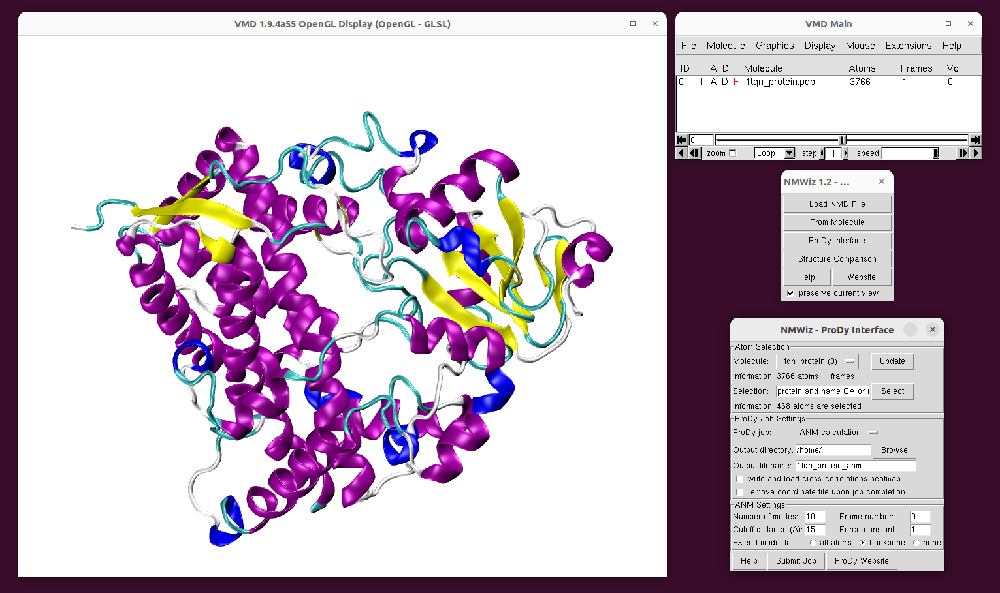

After the ANM calculation is completed, a new NMWiz window containing the
normal mode results will appear.

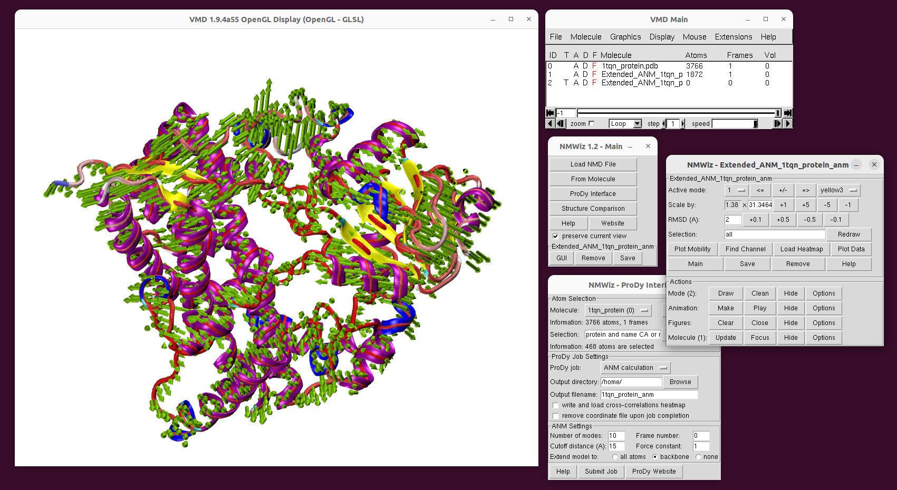

For this example, we use the following visualization settings.

Under ``MOLECULE``, open Options and change the protein representation from
``Tube`` to ``NewCartoon``.

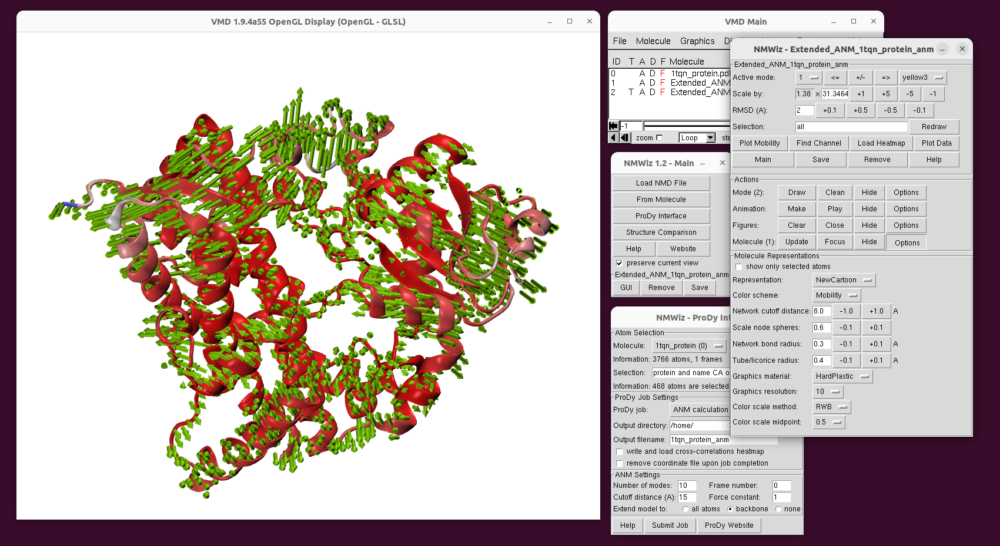

Under ``MODE``, select the mode that will be used to generate the
conformational ensemble. Here, Mode 1 is used with the default settings.
The choice of the mode and its amplitude should, however, be adjusted
according to the system and motion of interest.

Under ``ANIMATION``, set the number of frames to 20 and click ``Make``.
Twenty frames provide sufficient sampling for the example presented here
while keeping the subsequent CaviTracer calculations relatively fast.

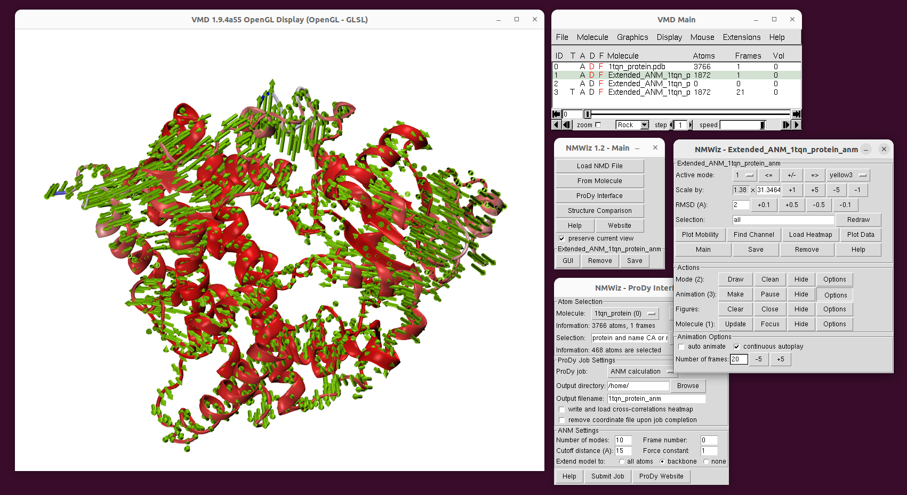

The generated frames represent conformations of the protein sampled along the
selected normal mode.

For a clearer visualization of the resulting ensemble, the initial protein
structure can be hidden in the VMD Main window by clicking ``D`` next to its
representation. The arrows showing the direction of the normal mode motion
can also be hidden if desired.

Channel detection
-------------------------------------------------------------------------------

Once the conformations along the selected normal mode have been generated,
CaviTracer can be used to detect channels in individual frames of the
ensemble.

Click ``Find Channels`` in the NMWiz window.

The CaviTracer window allows the parameters used for channel detection to be
adjusted according to the analyzed system. If ``Save details`` is selected,
detailed information about the detected channels will be written to the
selected output directory.

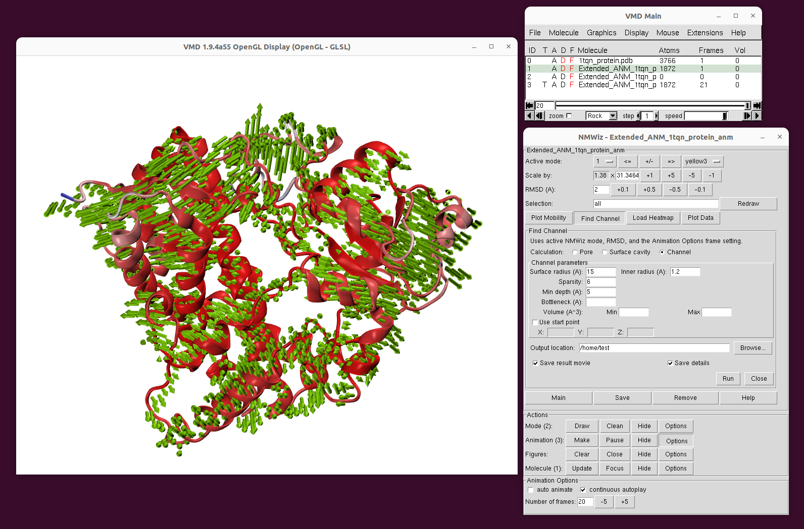

After the calculation is completed, the detected channels are displayed
directly in VMD for all analyzed conformations.

The results are also saved in NMD format. If ``Save animation`` is selected,
the conformational ensemble used in the analysis is additionally saved as a
PDB file. When ``Save details`` is enabled, detailed information describing
the detected channels is written to the selected output directory.

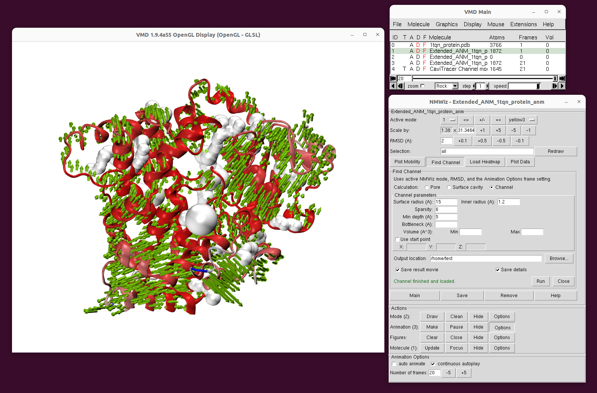

The resulting animation makes it possible to follow changes in the detected
channels along the selected normal mode.

.. image:: images/cavitracer_channels.gif
   :width: 70 %

**Channel detection using a start point**

Channel calculations can also be performed using a predefined
start point.

The start point can be used when the analysis should focus on channels
passing through a particular region of the protein, for example near an
active site or ligand-binding pocket. Channels located in other regions of
the structure are excluded from the resulting set.

Specify the coordinates of the start point in the CaviTracer window and run
the channel calculation again.

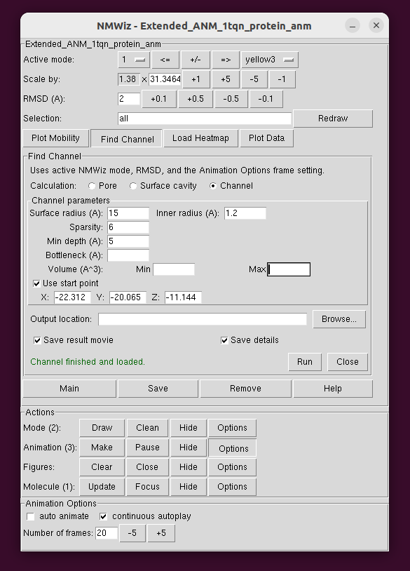

.. image:: images/cavitracer_channels_startpoint.gif
   :width: 70 %

Please note that when a new CaviTracer calculation is performed, for example 
after changing the channel parameters or start point, the previously displayed 
CaviTracer results are replaced by the results of the new calculation. 
Existing output files may also be overwritten when the same output location 
and filenames are used.

Pore detection
-------------------------------------------------------------------------------

Pores can be identified from the same NMWiz conformational ensemble by
selecting ``Pore`` instead of ``Channel``.

As for channels, the parameters should be adjusted according to the analyzed
system. In this example, the bottleneck radius is set to 1.2 Å, and
the minimum distance between the two pore ends is specified to restrict the
analysis to pathways spanning a sufficiently large region of the protein.

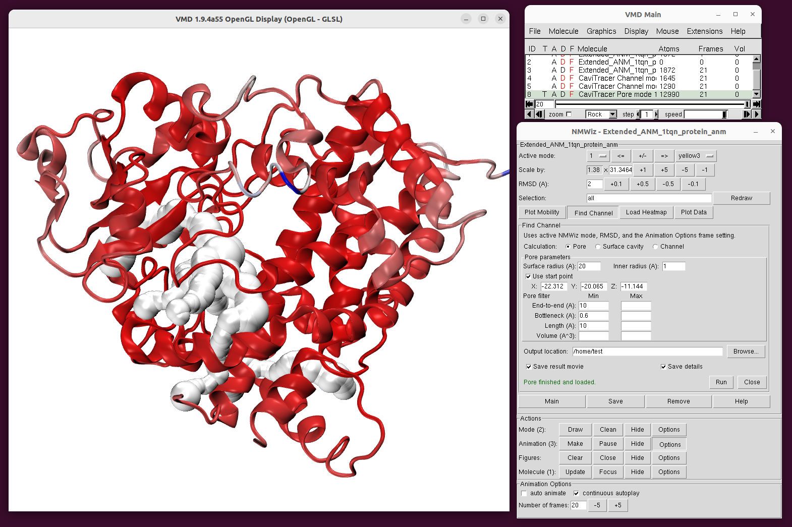

After the calculation is completed, the detected pores are displayed for the
individual conformations and can be followed along the selected normal mode.

.. image:: images/cavitracer_pores.gif
   :width: 70 %

Surface-cavity detection
-------------------------------------------------------------------------------

Surface cavities can be analyzed in the same way by selecting
``Surface cavity`` in the CaviTracer interface.

For the 1TQN example, the default CaviTracer parameters are used.

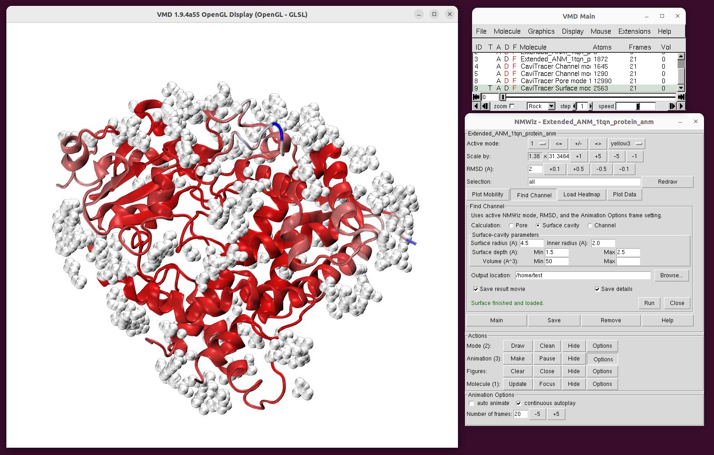

After the calculation is completed, the detected surface cavities are
displayed directly in VMD for the individual conformations.

By default, the cavities are shown using the representation generated by the
CaviTracer interface. If a surface representation is preferred, open

.. parsed-literal::

   Graphics -> Representations

in VMD and change the drawing method of the corresponding cavity
representation to QuickSurf.

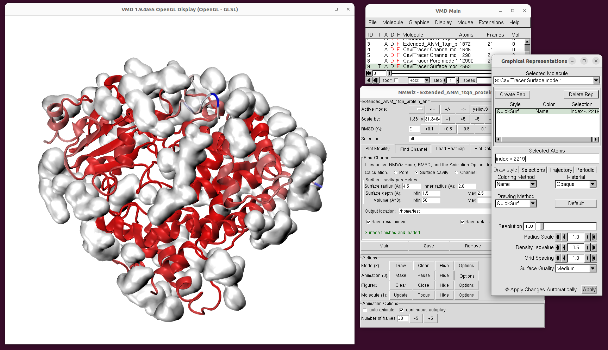

The resulting animation can then be used to inspect how the size and shape of
surface cavities change along the selected normal mode.

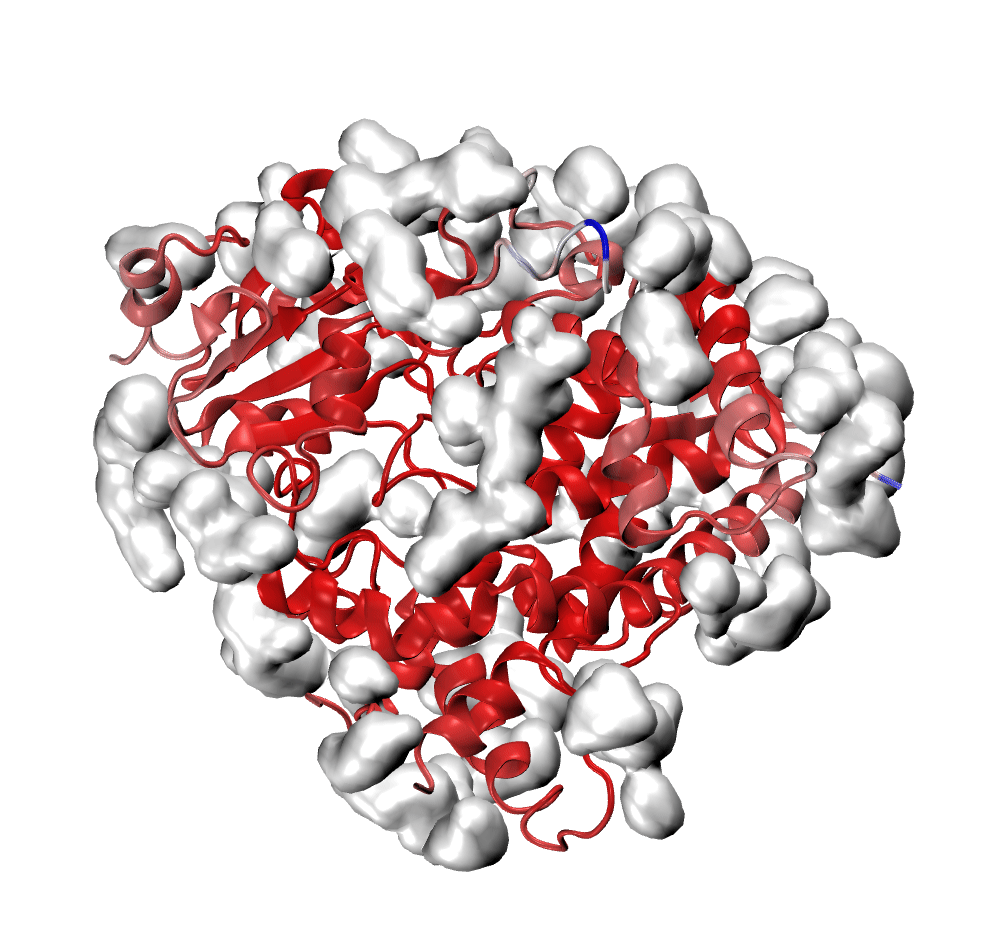

