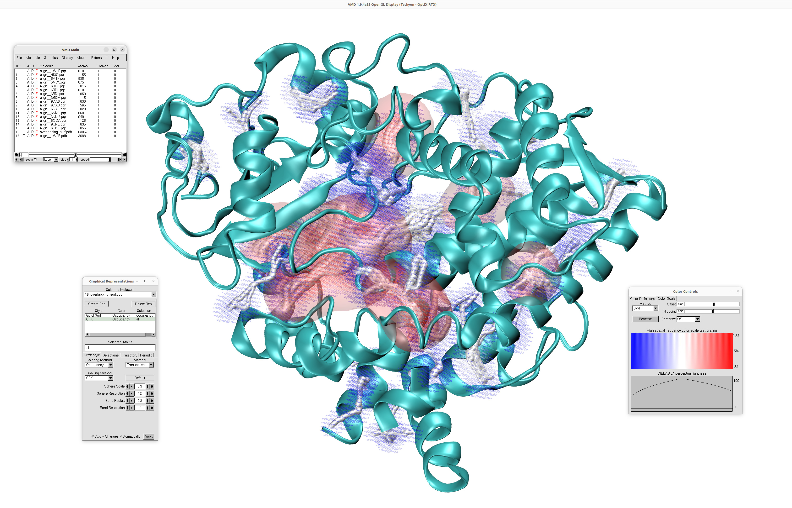
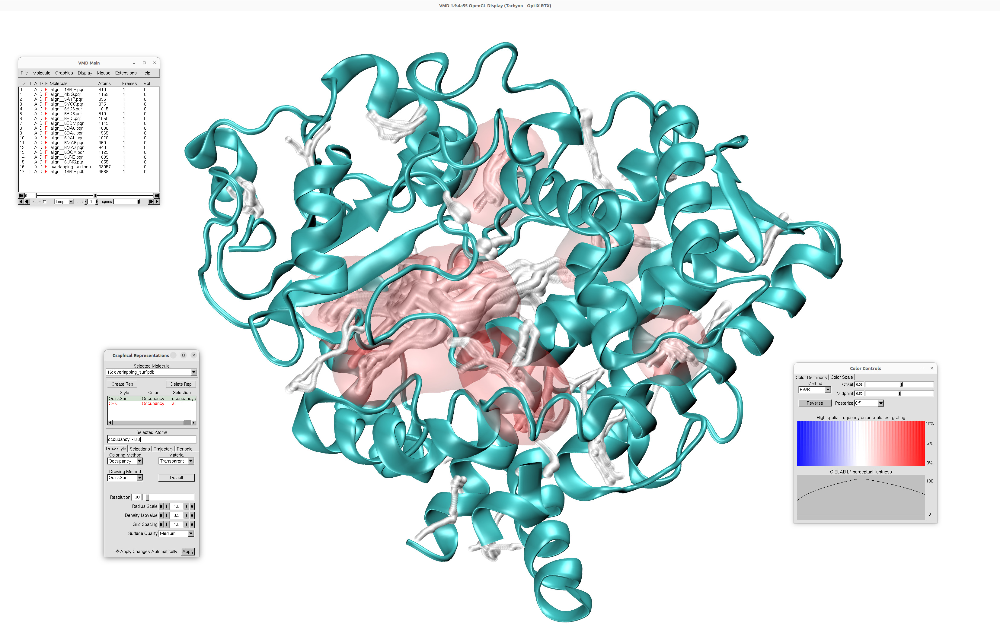
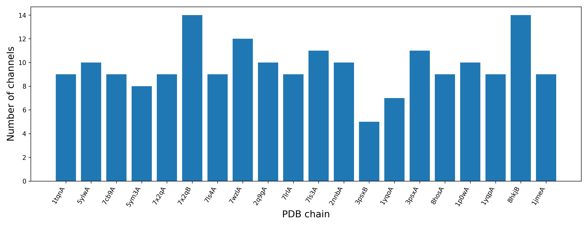

.. _cavitracer_single:

I. Detection of channels across heterogeneous structures
===============================================================================

Now, we will illustrate how to detect intraprotein channels across various PDB
structures. As an example, we will use Cytochrome P450. 

First, we will provide a list of PDB codes with different Cytochrome P450
structures. Such a list can be also provided by BLAST, Dali, or Foldseek
(see :func:`.runBLAST`, :func:`.runDali`, :func:`.runFoldseek` in the
`InSty tutorial`_).

.. ipython:: python
   :verbatim:

   pdb_files = ["1TQN", "1W0E", "4I3Q", "5A1P", "5VCC", "6BD6", "6BD8", "6BDI", 
            "6BDM", "6DA8", "6DAJ", "6DAL", "6MA6", "6MA7", "6OOA", "6UNE", "6UNG"]

Protein preparation
-------------------------------------------------------------------------------

Before performing the analysis, we will align all the structures onto the first
structure from our list (``target``) and save it under a new name with ``align__``
prefix. Such an approach was also shown in other ProDy tutorials and explained
in detail (see Structure Composition of the `Structure Analysis tutorial`_).

.. ipython:: python
   :verbatim:

   structures = parsePDB(pdb_files)
   target = structures[0]
   rmsds = []

   for mobile in structures[1:]:
       try:
           i = mobile.getTitle()
           print (i)
           matches = matchChains(mobile.protein, target.protein, subset='bb')
           m = matches[0]
           m0_alg, T = superpose(m[0], m[1], weights=m[0].getFlags("mapped"))
           rmsds.append(calcRMSD(m[0], m[1], weights=m[0].getFlags("mapped")))
           writePDB('align__'+i+'.pdb', mobile)
       except: pass

.. parsed-literal::

   @> 17 PDBs were parsed in 14.24s.
   1W0E
   @> Checking AtomGroup 1W0E: 1 chains are identified
   @> Checking AtomGroup 1TQN: 1 chains are identified
   @> Trying to match chains based on residue numbers and names:
   @>   Comparing Chain A from 1W0E (len=450) and Chain A from 1TQN (len=468):
   @> 	Match: 447 residues match with 99% sequence identity and 96% overlap.
   4I3Q
   @> Checking AtomGroup 4I3Q: 1 chains are identified
   @> Checking AtomGroup 1TQN: 1 chains are identified
   @> Trying to match chains based on residue numbers and names:
   @>   Comparing Chain A from 4I3Q (len=465) and Chain A from 1TQN (len=468):
   @> 	Match: 465 residues match with 100% sequence identity and 99% overlap.
   5A1P
   @> Checking AtomGroup 5A1P: 1 chains are identified
   @> Checking AtomGroup 1TQN: 1 chains are identified
   @> Trying to match chains based on residue numbers and names:
   @>   Comparing Chain A from 5A1P (len=465) and Chain A from 1TQN (len=468):
   @> 	Match: 463 residues match with 100% sequence identity and 99% overlap.
   5VCC
   @> Checking AtomGroup 5VCC: 1 chains are identified
   @> Checking AtomGroup 1TQN: 1 chains are identified
   @> Trying to match chains based on residue numbers and names:
   @>   Comparing Chain A from 5VCC (len=457) and Chain A from 1TQN (len=468):
   @> 	Match: 457 residues match with 100% sequence identity and 98% overlap.
   6BD6
   @> Checking AtomGroup 6BD6: 1 chains are identified
   @> Checking AtomGroup 1TQN: 1 chains are identified
   @> Trying to match chains based on residue numbers and names:
   @>   Comparing Chain A from 6BD6 (len=457) and Chain A from 1TQN (len=468):
   @> 	Match: 457 residues match with 100% sequence identity and 98% overlap.
   6BD8
   @> Checking AtomGroup 6BD8: 1 chains are identified
   @> Checking AtomGroup 1TQN: 1 chains are identified
   @> Trying to match chains based on residue numbers and names:
   @>   Comparing Chain A from 6BD8 (len=457) and Chain A from 1TQN (len=468):
   @> 	Match: 457 residues match with 100% sequence identity and 98% overlap.
   6BDI
   @> Checking AtomGroup 6BDI: 1 chains are identified
   @> Checking AtomGroup 1TQN: 1 chains are identified
   @> Trying to match chains based on residue numbers and names:
   @>   Comparing Chain A from 6BDI (len=462) and Chain A from 1TQN (len=468):
   @> 	Match: 461 residues match with 100% sequence identity and 99% overlap.
   6BDM
   @> Checking AtomGroup 6BDM: 1 chains are identified
   @> Checking AtomGroup 1TQN: 1 chains are identified
   @> Trying to match chains based on residue numbers and names:
   @>   Comparing Chain A from 6BDM (len=456) and Chain A from 1TQN (len=468):
   @> 	Match: 456 residues match with 100% sequence identity and 97% overlap.
   6DA8
   @> Checking AtomGroup 6DA8: 1 chains are identified
   @> Checking AtomGroup 1TQN: 1 chains are identified
   @> Trying to match chains based on residue numbers and names:
   @>   Comparing Chain A from 6DA8 (len=451) and Chain A from 1TQN (len=468):
   @> 	Match: 450 residues match with 100% sequence identity and 96% overlap.
   6DAJ
   @> Checking AtomGroup 6DAJ: 1 chains are identified
   @> Checking AtomGroup 1TQN: 1 chains are identified
   @> Trying to match chains based on residue numbers and names:
   @>   Comparing Chain A from 6DAJ (len=451) and Chain A from 1TQN (len=468):
   @> 	Match: 450 residues match with 100% sequence identity and 96% overlap.
   6DAL
   @> Checking AtomGroup 6DAL: 1 chains are identified
   @> Checking AtomGroup 1TQN: 1 chains are identified
   @> Trying to match chains based on residue numbers and names:
   @>   Comparing Chain A from 6DAL (len=454) and Chain A from 1TQN (len=468):
   @> 	Match: 453 residues match with 100% sequence identity and 97% overlap.
   6MA6
   @> Checking AtomGroup 6MA6: 1 chains are identified
   @> Checking AtomGroup 1TQN: 1 chains are identified
   @> Trying to match chains based on residue numbers and names:
   @>   Comparing Chain A from 6MA6 (len=466) and Chain A from 1TQN (len=468):
   @> 	Match: 464 residues match with 100% sequence identity and 99% overlap.
   6MA7
   @> Checking AtomGroup 6MA7: 1 chains are identified
   @> Checking AtomGroup 1TQN: 1 chains are identified
   @> Trying to match chains based on residue numbers and names:
   @>   Comparing Chain A from 6MA7 (len=463) and Chain A from 1TQN (len=468):
   @> 	Match: 461 residues match with 99% sequence identity and 99% overlap.
   6OOA
   @> Checking AtomGroup 6OOA: 1 chains are identified
   @> Checking AtomGroup 1TQN: 1 chains are identified
   @> Trying to match chains based on residue numbers and names:
   @>   Comparing Chain A from 6OOA (len=452) and Chain A from 1TQN (len=468):
   @> 	Match: 452 residues match with 100% sequence identity and 97% overlap.
   6UNE
   @> Checking AtomGroup 6UNE: 1 chains are identified
   @> Checking AtomGroup 1TQN: 1 chains are identified
   @> Trying to match chains based on residue numbers and names:
   @>   Comparing Chain A from 6UNE (len=452) and Chain A from 1TQN (len=468):
   @> 	Match: 452 residues match with 100% sequence identity and 97% overlap.
   6UNG
   @> Checking AtomGroup 6UNG: 1 chains are identified
   @> Checking AtomGroup 1TQN: 1 chains are identified
   @> Trying to match chains based on residue numbers and names:
   @>   Comparing Chain A from 6UNG (len=453) and Chain A from 1TQN (len=468):
   @> 	Match: 453 residues match with 100% sequence identity and 97% overlap.

The names of the structurally aligned PDBs are further uploaded into ``pdb_files_new``.
This operation is required if we want to compare the localization of channels in
various PDB models.

.. ipython:: python
   :verbatim:

   from pathlib import Path
   pdb_files_new = [p.name for p in Path(".").glob("align__*.pdb")]
   pdb_files_new

.. parsed-literal::

   ['align__6OOA.pdb',
    'align__6BD8.pdb',
    'align__6BD6.pdb',
    'align__6BDI.pdb',
    'align__6DAJ.pdb',
    'align__5A1P.pdb',
    'align__6BDM.pdb',
    'align__6DA8.pdb',
    'align__4I3Q.pdb',
    'align__6UNG.pdb',
    'align__6UNE.pdb',
    'align__6DAL.pdb',
    'align__6MA6.pdb',
    'align__1W0E.pdb',
    'align__6MA7.pdb',
    'align__5VCC.pdb']

Channel prediction for individual PDB files
-------------------------------------------------------------------------------

Now, all PDB structures can be analyzed to detect channels, tunnels, or
pores in the protein structure using :func:`.calcChannels`. In this example,
the results will be saved in a single file (all detected channels in ``.pqr``
file with the name of the input file) and in multiple files (``separate``
must be set to ``True``) to save each detected channel independently.
Additionally, we will use :func:`.getChannelParameters` and
:func:`.getChannelResidueNames` to obtain information about channel
parameters and residues involved in its formation. To save this information
in the local directory, we provide ``param_file_name`` and
``residues_file_name``. The function will create files with the same name as
provided PDB with ``'_Parameters_All_channels.txt'`` and
``'_Residues_All_channels.txt'`` as suffixes.

.. ipython:: python
   :verbatim:

   for i in pdb_files_new:
       base_name = pdb_files_new[0]
       atoms = parsePDB(i).select('protein')
       channels2, surface2 = calcChannels(atoms, output_path=i[:-4], separate=True)

       getChannelParameters(channels2, param_file_name=i[:-4])
       getChannelResidueNames(atoms, channels2, residues_file_name=i[:-4])

.. parsed-literal::

    @> 3727 atoms and 1 coordinate set(s) were parsed in 0.04s.
    @> The atoms supplied to calcChannels contain protein atoms only.
    @> Substituted 3630 atoms with 22830 homogeneous balls of radius 1.52 Å in 0.17s.
    @> Delaunay tessellation of 22830 points constructed in 0.78s.
    @> Surface and inner simplices filtered in 1.93s.
    @> Cavities: 145 found, 9 deeper than min_depth=5.0 Å and searched for channels, in 0.31s.
    @> Chambers (probe 1.40 Å): 6 of the 9 searched cavities have them; the other 4 are searched whole.
    @>     cavity 0: 26 chambers, 5 of them seeded.
    @>     cavity 1: 3 chambers, 1 of them seeded.
    @>     cavity 2: 1 chamber, seeded.
    @>     cavity 3: 3 chambers, 1 of them seeded.
    @>     cavity 4: 2 chambers, all seeded.
    @>     cavity 7: 1 chamber, none of them deep and large enough to seed; searched whole.
    @> 14 search sites (sp) in 0.06s: one per seeded chamber, one per cavity searched whole.
    @> Channel search (Dijkstra) over 14 search sites in 9 cavities completed in 0.22s.
    @> Found 16 channels and 2 links (a link joins a deep chamber to a shallower one and never reaches the surface).
    @> Search sites (sp), the void each search ran from, largest first; sp<n> tags every channel, link and output file:
    @>     site  start_point [Å]              void                   volume [ų]  depth [Å]  channels  links
    @>     sp0   [-22.739, -17.762, -10.690]  cavity 0, chamber 1/5         4060        8.2         6      -
    @>     sp1   [-27.340, -26.783, -1.430]   cavity 0, chamber 2/5          262        8.0         1      -
    @>     sp2   [-13.431, -37.424, -4.075]   cavity 5, whole                221        5.5         1      -
    @>     sp3   [-25.317, -31.316, -6.063]   cavity 0, chamber 3/5          206       16.1         -      -  sealed
    @>     sp4   [-24.901, -41.642, -11.119]  cavity 2, chamber 1/1          189        8.9         -      -  sealed
    @>     sp5   [-28.738, -46.393, -21.582]  cavity 6, whole                184        5.1         1      -
    @>     sp6   [-17.407, 3.345, -18.881]    cavity 7, whole                173        5.3         1      -
    @>     sp7   [-11.248, -24.855, 4.687]    cavity 8, whole                159        5.4         1      -
    @>     sp8   [-22.709, -14.923, -23.709]  cavity 0, chamber 4/5          139       14.5         -      1  -> sp0
    @>     sp9   [-19.542, -43.656, -16.249]  cavity 4, chamber 1/2           85       11.5         -      1  -> sp10
    @>     sp10  [-15.393, -42.639, -12.731]  cavity 4, chamber 2/2           80        5.5         1      -
    @>     sp11  [-9.092, -31.126, -5.657]    cavity 1, chamber 1/1           67        5.4         2      -
    @>     sp12  [-27.968, -18.011, -23.364]  cavity 0, chamber 5/5           59        5.3         2      -
    @>     sp13  [-27.143, -36.831, -31.674]  cavity 3, chamber 1/1           54        9.1         -      -  sealed
    @>     (site volumes measure the void itself and are not on the swept-sphere scale of the channel volumes)
    @> The 3 sites marked sealed above report neither a channel nor a link: no route out of them survived - either narrower than bottleneck=1.20 Å, or dropped as a duplicate of a shallower site's, or the void is its own mouth and has nowhere to path to. Lower bottleneck to see how the first kind connect.
    @> Saving 16 channels and 2 links to directory ., one file per object named sp<site>_chl<n> and sp<site>_lnk<n>.
    @> Channel calculation completed in 3.43s.
    @> Channel ID:      Volume [ų]     Length [Å]      Bottleneck [Å]
    @> channel 0:       775.73          8.2             3.22
    @> channel 1:       967.38          12.29           2.8
    @> channel 2:       97.89           5.69            1.87
    @> channel 3:       637.99          11.02           1.6
    @> channel 4:       591.75          10.78           1.68
    @> channel 5:       72.55           5.45            1.42
    @> channel 6:       1011.37                 16.64           1.65
    @> channel 7:       54.3            5.33            1.23
    @> channel 8:       1032.07                 18.43           1.94
    @> channel 9:       134.88          8.02            1.45
    @> channel 10:      52.55           5.2             1.25
    @> channel 11:      50.39           5.51            1.26
    @> channel 12:      57.23           5.5             1.24
    @> channel 13:      57.52           5.4             1.21
    @> channel 14:      46.83           5.5             1.2
    @> channel 15:      136.16          10.37           1.28
    @> Channel residues were saved to: align__6OOA_Residues_All_channels.txt
    ..
    ..
    @> 3882 atoms and 1 coordinate set(s) were parsed in 0.04s.
    @> The atoms supplied to calcChannels contain protein atoms only.
    @> Substituted 3720 atoms with 23368 homogeneous balls of radius 1.52 Å in 0.16s.
    @> Delaunay tessellation of 23368 points constructed in 0.73s.
    @> Surface and inner simplices filtered in 1.85s.
    @> Cavities: 145 found, 10 deeper than min_depth=5.0 Å and searched for channels, in 0.29s.
    @> Chambers (probe 1.40 Å): 8 of the 10 searched cavities have them; the other 6 are searched whole.
    @>     cavity 0: 14 chambers, 3 of them seeded.
    @>     cavity 2: 4 chambers, 1 of them seeded.
    @>     cavity 3: 1 chamber, seeded.
    @>     cavity 4: 2 chambers, 1 of them seeded.
    @>     cavity 5: 1 chamber, none of them deep and large enough to seed; searched whole.
    @>     cavity 6: 2 chambers, none of them deep and large enough to seed; searched whole.
    @>     cavity 7: 1 chamber, none of them deep and large enough to seed; searched whole.
    @>     cavity 8: 1 chamber, none of them deep and large enough to seed; searched whole.
    @> 12 search sites (sp) in 0.06s: one per seeded chamber, one per cavity searched whole.
    @> Channel search (Dijkstra) over 12 search sites in 10 cavities completed in 0.22s.
    @> Found 13 channels and 1 link (a link joins a deep chamber to a shallower one and never reaches the surface).
    @> Search sites (sp), the void each search ran from, largest first; sp<n> tags every channel, link and output file:
    @>     site  start_point [Å]              void                   volume [ų]  depth [Å]  channels  links
    @>     sp0   [-20.317, -17.687, -11.117]  cavity 0, chamber 1/3         4379       13.6         3      -
    @>     sp1   [-10.376, -21.751, -13.490]  cavity 1, whole               1083        5.2         -      -  sealed
    @>     sp2   [-28.046, -16.350, -21.344]  cavity 5, whole                328        5.6         1      -
    @>     sp3   [-30.637, -30.877, -28.063]  cavity 6, whole                212        5.0         1      -
    @>     sp4   [-25.189, -42.244, -11.167]  cavity 3, chamber 1/1          206        8.0         1      -
    @>     sp5   [-16.336, -41.507, -13.054]  cavity 7, whole                169        5.3         1      -
    @>     sp6   [-28.885, -46.170, -21.266]  cavity 8, whole                153        5.1         1      -
    @>     sp7   [-9.029, -11.855, -25.151]   cavity 9, whole                128        7.3         -      -  sealed
    @>     sp8   [-9.562, -30.917, -5.403]    cavity 4, chamber 1/1          106        5.4         1      -
    @>     sp9   [-12.520, -24.020, 7.203]    cavity 0, chamber 2/3           59        5.6         2      -
    @>     sp10  [-24.705, -25.684, -11.042]  cavity 0, chamber 3/3           57       23.6         -      1  -> sp0
    @>     sp11  [-28.256, -30.724, -21.745]  cavity 2, chamber 1/1           54        5.3         2      -
    @>     (site volumes measure the void itself and are not on the swept-sphere scale of the channel volumes)
    @> The 2 sites marked sealed above report neither a channel nor a link: no route out of them survived - either narrower than bottleneck=1.20 Å, or dropped as a duplicate of a shallower site's, or the void is its own mouth and has nowhere to path to. Lower bottleneck to see how the first kind connect.
    @> Saving 13 channels and 1 links to directory ., one file per object named sp<site>_chl<n> and sp<site>_lnk<n>.
    @> Channel calculation completed in 3.27s.
    @> Channel ID:      Volume [ų]     Length [Å]      Bottleneck [Å]
    @> channel 0:       128.0           5.35            1.72
    @> channel 1:       91.93           5.61            1.4
    @> channel 2:       66.55           5.4             1.46
    @> channel 3:       58.31           5.11            1.48
    @> channel 4:       76.47           5.48            1.24
    @> channel 5:       85.11           6.45            1.52
    @> channel 6:       733.63          20.27           2.43
    @> channel 7:       54.88           5.16            1.22
    @> channel 8:       51.96           5.6             1.32
    @> channel 9:       456.21          13.71           1.64
    @> channel 10:      119.14          8.21            1.27
    @> channel 11:      87.29           8.26            1.36
    @> channel 12:      593.35          22.09           1.21
    @> Channel residues were saved to: align__6MA7_Residues_All_channels.txt
    @> 4124 atoms and 1 coordinate set(s) were parsed in 0.05s.
    @> The atoms supplied to calcChannels contain protein atoms only.
    @> Substituted 3675 atoms with 23131 homogeneous balls of radius 1.52 Å in 0.16s.
    @> Delaunay tessellation of 23131 points constructed in 0.71s.
    @> Surface and inner simplices filtered in 1.70s.
    @> Cavities: 150 found, 9 deeper than min_depth=5.0 Å and searched for channels, in 0.29s.
    @> Chambers (probe 1.40 Å): 8 of the 9 searched cavities have them; the other 6 are searched whole.
    @>     cavity 0: 11 chambers, 3 of them seeded.
    @>     cavity 1: 1 chamber, seeded.
    @>     cavity 2: 1 chamber, seeded.
    @>     cavity 3: 1 chamber, none of them deep and large enough to seed; searched whole.
    @>     cavity 4: 2 chambers, none of them deep and large enough to seed; searched whole.
    @>     cavity 5: 2 chambers, none of them deep and large enough to seed; searched whole.
    @>     cavity 6: 3 chambers, none of them deep and large enough to seed; searched whole.
    @>     cavity 7: 1 chamber, none of them deep and large enough to seed; searched whole.
    @> 11 search sites (sp) in 0.06s: one per seeded chamber, one per cavity searched whole.
    @> Channel search (Dijkstra) over 11 search sites in 9 cavities completed in 0.20s.
    @> Found 12 channels and 1 link (a link joins a deep chamber to a shallower one and never reaches the surface).
    @> Search sites (sp), the void each search ran from, largest first; sp<n> tags every channel, link and output file:
    @>     site  start_point [Å]              void                   volume [ų]  depth [Å]  channels  links
    @>     sp0   [-17.602, -19.728, -11.814]  cavity 0, chamber 1/3         4491       15.1         3      -
    @>     sp1   [-27.975, -17.395, -22.773]  cavity 3, whole                439        5.1         1      -
    @>     sp2   [-15.364, -42.346, -12.635]  cavity 4, whole                314        5.1         1      -
    @>     sp3   [-23.632, -30.164, -27.285]  cavity 5, whole                284        6.8         1      -
    @>     sp4   [-30.186, -31.099, -28.502]  cavity 6, whole                224        5.0         1      -
    @>     sp5   [-25.527, -42.082, -11.325]  cavity 2, chamber 1/1          224        9.3         -      -  sealed
    @>     sp6   [-9.478, -31.244, -5.484]    cavity 1, chamber 1/1          174        8.4         2      -
    @>     sp7   [-17.420, 3.313, -18.466]    cavity 7, whole                159        5.3         1      -
    @>     sp8   [-30.850, -19.290, 3.062]    cavity 8, whole                116        5.1         1      -
    @>     sp9   [-29.245, -32.774, -21.098]  cavity 0, chamber 2/3           75        5.4         1      -
    @>     sp10  [-26.068, -29.878, -22.304]  cavity 0, chamber 3/3           66        6.3         -      1  -> sp9
    @>     (site volumes measure the void itself and are not on the swept-sphere scale of the channel volumes)
    @> The 1 site marked sealed above report neither a channel nor a link: no route out of them survived - either narrower than bottleneck=1.20 Å, or dropped as a duplicate of a shallower site's, or the void is its own mouth and has nowhere to path to. Lower bottleneck to see how the first kind connect.
    @> Saving 12 channels and 1 links to directory ., one file per object named sp<site>_chl<n> and sp<site>_lnk<n>.
    @> Channel calculation completed in 3.07s.
    @> Channel ID:      Volume [ų]     Length [Å]      Bottleneck [Å]
    @> channel 0:       132.35          5.49            1.84
    @> channel 1:       98.53           5.09            1.83
    @> channel 2:       69.55           5.08            1.63
    @> channel 3:       66.51           5.5             1.46
    @> channel 4:       53.65           5.4             1.29
    @> channel 5:       747.27          22.16           2.48
    @> channel 6:       432.11          15.22           1.63
    @> channel 7:       39.53           5.1             1.2
    @> channel 8:       121.43          6.8             1.28
    @> channel 9:       137.39          9.32            1.5
    @> channel 10:      96.81           8.68            1.22
    @> channel 11:      453.96          18.81           1.3
    @> Channel residues were saved to: align__5VCC_Residues_All_channels.txt

Selection of channels in a certain protein area
-------------------------------------------------------------------------------

CaviTracer will generate multiple channels, but we might be interested only
in the channels that are localized in a certain region. For that reason, we
created :func:`.selectChannelBySelection` which can extract channels that
are localized near the region of our interest. Below, we first select which
``pqr_files`` files we want to analyze (to exclude all channels in one file
that is also saved by default). Next, we use the ``residue_sele`` option to
apply any selection that is understandable by ProDy select. In our case, we
select all ``FIL`` atoms (channel prediction artificial atoms) that are
within 5 Angstroms from the residue with the number 442. These values can be
changed using ``distA`` parameter of the function.

.. ipython:: python
   :verbatim:

   from pathlib import Path
   pdb_files_new_channels = [i.name for i in Path(".").glob("align__*chl*.pqr") if i.is_file()]
   pdb_files_new_channels

.. parsed-literal::

    ['align__6OOA_sp10_chl12.pqr',
     'align__1W0E_sp1_chl2.pqr',
     'align__4I3Q_sp1_chl5.pqr',
     'align__4I3Q_sp3_chl2.pqr',
     'align__6MA6_sp1_chl1.pqr',
     'align__6BD8_sp5_chl9.pqr',
     'align__6BD6_sp1_chl1.pqr',
     'align__1W0E_sp13_chl8.pqr',
     'align__6MA7_sp9_chl8.pqr',
     'align__6DAL_sp2_chl4.pqr',
     'align__6DAL_sp5_chl11.pqr',
     'align__5VCC_sp7_chl4.pqr',
     'align__6UNE_sp6_chl11.pqr',
     'align__6UNG_sp12_chl11.pqr',
     'align__1W0E_sp11_chl7.pqr',
     'align__6UNG_sp0_chl1.pqr',
     'align__6BDM_sp10_chl11.pqr',
     'align__5A1P_sp0_chl8.pqr',
     'align__1W0E_sp2_chl11.pqr',
     'align__6UNE_sp10_chl2.pqr',
     'align__6BDM_sp11_chl7.pqr',
     'align__6BD8_sp7_chl7.pqr',
     'align__6UNG_sp10_chl5.pqr',
     'align__6MA6_sp8_chl2.pqr',
     'align__6MA7_sp2_chl1.pqr',
     'align__6MA7_sp0_chl12.pqr',
     'align__6BD8_sp0_chl2.pqr',
     'align__6BD6_sp10_chl0.pqr',
     'align__6BDM_sp0_chl8.pqr',
     'align__6DAJ_sp6_chl16.pqr',
     'align__6MA6_sp5_chl5.pqr',
     'align__6UNG_sp0_chl4.pqr',
     'align__5VCC_sp0_chl5.pqr',
     'align__6UNG_sp8_chl7.pqr',
     'align__6BD6_sp13_chl2.pqr',
     'align__4I3Q_sp0_chl6.pqr',
     'align__5A1P_sp0_chl10.pqr',
     ..
     ..
     'align__1W0E_sp7_chl0.pqr',
     'align__6BD6_sp0_chl6.pqr',
     'align__6DAL_sp0_chl0.pqr',
     'align__5VCC_sp0_chl6.pqr',
     'align__6UNG_sp6_chl6.pqr',
     'align__6MA6_sp0_chl4.pqr',
     'align__6MA7_sp8_chl4.pqr',
     'align__1W0E_sp0_chl3.pqr',
     'align__6BD6_sp4_chl7.pqr']

.. ipython:: python
   :verbatim:

   atoms = parsePDB(pdb_files_new_channels[0].split('_sp')[0]+'.pdb')
   selectChannelBySelection(atoms, pqr_files=pdb_files_new_channels, 
					residue_sele='resid 442')

.. parsed-literal::

    @> 3727 atoms and 1 coordinate set(s) were parsed in 0.05s.
    @> 55 atoms and 1 coordinate sets were parsed in 0.00s.
    @> 35 atoms and 1 coordinate sets were parsed in 0.00s.
    @> 40 atoms and 1 coordinate sets were parsed in 0.00s.
    @> 40 atoms and 1 coordinate sets were parsed in 0.00s.
    @> 60 atoms and 1 coordinate sets were parsed in 0.00s.
    @> 50 atoms and 1 coordinate sets were parsed in 0.00s.
    @> 35 atoms and 1 coordinate sets were parsed in 0.00s.
    @> 55 atoms and 1 coordinate sets were parsed in 0.00s.
    @> 60 atoms and 1 coordinate sets were parsed in 0.00s.
    @> 60 atoms and 1 coordinate sets were parsed in 0.00s.
    @> 50 atoms and 1 coordinate sets were parsed in 0.00s.
    @> 45 atoms and 1 coordinate sets were parsed in 0.00s.
    @> 80 atoms and 1 coordinate sets were parsed in 0.00s.
    @> 90 atoms and 1 coordinate sets were parsed in 0.00s.
    @> 75 atoms and 1 coordinate sets were parsed in 0.00s.
    @> 55 atoms and 1 coordinate sets were parsed in 0.00s.
    @> 115 atoms and 1 coordinate sets were parsed in 0.00s.
    @> 100 atoms and 1 coordinate sets were parsed in 0.00s.
    @> 100 atoms and 1 coordinate sets were parsed in 0.00s.
    @> 50 atoms and 1 coordinate sets were parsed in 0.00s.
    @> 70 atoms and 1 coordinate sets were parsed in 0.00s.
    @> 60 atoms and 1 coordinate sets were parsed in 0.00s.
    @> 60 atoms and 1 coordinate sets were parsed in 0.00s.
    @> 85 atoms and 1 coordinate sets were parsed in 0.00s.
    @> 45 atoms and 1 coordinate sets were parsed in 0.00s.
    @> 190 atoms and 1 coordinate sets were parsed in 0.00s.
    @> 90 atoms and 1 coordinate sets were parsed in 0.00s.
    @> 50 atoms and 1 coordinate sets were parsed in 0.00s.
    @> 125 atoms and 1 coordinate sets were parsed in 0.00s.
    @> 60 atoms and 1 coordinate sets were parsed in 0.00s.
    @> 45 atoms and 1 coordinate sets were parsed in 0.00s.
    @> 95 atoms and 1 coordinate sets were parsed in 0.00s.
    @> 135 atoms and 1 coordinate sets were parsed in 0.00s.
    @> 40 atoms and 1 coordinate sets were parsed in 0.00s.
    @> 75 atoms and 1 coordinate sets were parsed in 0.00s.
    @> 115 atoms and 1 coordinate sets were parsed in 0.00s.
    ..
    ..
    @> 150 atoms and 1 coordinate sets were parsed in 0.00s.
    @> 100 atoms and 1 coordinate sets were parsed in 0.00s.
    @> 55 atoms and 1 coordinate sets were parsed in 0.00s.
    @> 90 atoms and 1 coordinate sets were parsed in 0.00s.
    @> 60 atoms and 1 coordinate sets were parsed in 0.00s.
    @> 45 atoms and 1 coordinate sets were parsed in 0.00s.
    @> 40 atoms and 1 coordinate sets were parsed in 0.00s.
    @> 40 atoms and 1 coordinate sets were parsed in 0.00s.
    @> 40 atoms and 1 coordinate sets were parsed in 0.00s.
    @> 60 atoms and 1 coordinate sets were parsed in 0.00s.
    @> 125 atoms and 1 coordinate sets were parsed in 0.00s.
    @> 55 atoms and 1 coordinate sets were parsed in 0.00s.
    @> 100 atoms and 1 coordinate sets were parsed in 0.00s.
    @> 40 atoms and 1 coordinate sets were parsed in 0.00s.
    @> 95 atoms and 1 coordinate sets were parsed in 0.00s.
    @> 55 atoms and 1 coordinate sets were parsed in 0.00s.
    @> 80 atoms and 1 coordinate sets were parsed in 0.00s.
    @> 50 atoms and 1 coordinate sets were parsed in 0.00s.
    @> Filtered files are now in: selected_files
    @> Selected files: 
    @> align__5A1P_sp0_chl8.pqr align__5A1P_sp0_chl10.pqr align__4I3Q_sp7_chl10.pqr align__5A1P_sp0_chl5.pqr align__6BD8_sp3_chl10.pqr align__5A1P_sp5_chl7.pqr align__5VCC_sp6_chl9.pqr

If we do not provide ``folder_name``, the results will be copied into the folder
``selected_file``, which is created automatically. That name can be changed using
``folder_name``, as shown below. Additionally, if we generated in the previous
step files with parameters and residues for the channels, we can also use
options ``residues_file`` and ``param_file`` set to ``True``. Then two new
files will be created **Selected_channel_residues.txt** and
**Selected_channel_parameters.txt**. In those files, we will find data for
selected channels only. 

.. ipython:: python
   :verbatim:

   atoms = parsePDB(pdb_files_new_channels[0].split('_sp')[0]+'.pdb')
   selectChannelBySelection(atoms, pqr_files=pdb_files_new_channels, residue_sele='resid 442',
   folder_name='res442', residues_file=True, param_file=True)

.. parsed-literal::

    @> 3727 atoms and 1 coordinate set(s) were parsed in 0.05s.
    @> 55 atoms and 1 coordinate sets were parsed in 0.00s.
    @> 35 atoms and 1 coordinate sets were parsed in 0.00s.
    @> 40 atoms and 1 coordinate sets were parsed in 0.00s.
    @> 40 atoms and 1 coordinate sets were parsed in 0.00s.
    @> 60 atoms and 1 coordinate sets were parsed in 0.00s.
    @> 50 atoms and 1 coordinate sets were parsed in 0.00s.
    @> 35 atoms and 1 coordinate sets were parsed in 0.00s.
    @> 55 atoms and 1 coordinate sets were parsed in 0.00s.
    @> 60 atoms and 1 coordinate sets were parsed in 0.00s.
    @> 60 atoms and 1 coordinate sets were parsed in 0.00s.
    @> 50 atoms and 1 coordinate sets were parsed in 0.00s.
    @> 45 atoms and 1 coordinate sets were parsed in 0.00s.
    @> 80 atoms and 1 coordinate sets were parsed in 0.00s.
    @> 90 atoms and 1 coordinate sets were parsed in 0.00s.
    @> 75 atoms and 1 coordinate sets were parsed in 0.00s.
    @> 55 atoms and 1 coordinate sets were parsed in 0.00s.
    @> 115 atoms and 1 coordinate sets were parsed in 0.00s.
    @> 100 atoms and 1 coordinate sets were parsed in 0.00s.
    @> 100 atoms and 1 coordinate sets were parsed in 0.00s.
    @> 50 atoms and 1 coordinate sets were parsed in 0.00s.
    @> 70 atoms and 1 coordinate sets were parsed in 0.00s.
    @> 60 atoms and 1 coordinate sets were parsed in 0.00s.
    @> 60 atoms and 1 coordinate sets were parsed in 0.00s.
    @> 85 atoms and 1 coordinate sets were parsed in 0.00s.
    ..
    ..
    @> 125 atoms and 1 coordinate sets were parsed in 0.00s.
    @> 55 atoms and 1 coordinate sets were parsed in 0.00s.
    @> 100 atoms and 1 coordinate sets were parsed in 0.00s.
    @> 40 atoms and 1 coordinate sets were parsed in 0.00s.
    @> 95 atoms and 1 coordinate sets were parsed in 0.00s.
    @> 55 atoms and 1 coordinate sets were parsed in 0.00s.
    @> 80 atoms and 1 coordinate sets were parsed in 0.00s.
    @> 50 atoms and 1 coordinate sets were parsed in 0.00s.
    @> Filtered files are now in: res442
    @> 7 residue row(s) saved to: Selected_channel_residues.txt
    @> 7 parameter row(s) saved to: Selected_channel_parameters.txt
    @> Selected files: 
    @> align__5A1P_sp0_chl8.pqr align__5A1P_sp0_chl10.pqr align__4I3Q_sp7_chl10.pqr align__5A1P_sp0_chl5.pqr align__6BD8_sp3_chl10.pqr align__5A1P_sp5_chl7.pqr align__5VCC_sp6_chl9.pqr

Calculating overlapping channel regions across PDB structures
-------------------------------------------------------------------------------

Now, we will select files for analysis. In our case, we will select files with
all predicted channels in one file that starts with ``'align__'``. 

.. ipython:: python
   :verbatim:

   from pathlib import Path
   pdb_files_new_channels_ALL = [i.name for i in Path(".").glob("align__????.pqr") if i.is_file()]
   pdb_files_new_channels_ALL

.. parsed-literal::

   ['align__4I3Q.pqr',
    'align__6BDM.pqr',
    'align__6UNG.pqr',
    'align__6OOA.pqr',
    'align__6MA7.pqr',
    'align__6DAJ.pqr',
    'align__5A1P.pqr',
    'align__1W0E.pqr',
    'align__6BD6.pqr',
    'align__6UNE.pqr',
    'align__5VCC.pqr',
    'align__6BD8.pqr',
    'align__6BDI.pqr',
    'align__6DAL.pqr',
    'align__6MA6.pqr',
    'align__6DA8.pqr']   

To compute the so-called overlapping surface of the detected channels, we
should use :func:`.calcChannelSurfaceOverlaps`. To save the results, we
need to specify ``output_file_name``.

.. ipython:: python
   :verbatim:

   calcChannelSurfaceOverlaps(pqr_files=pdb_files_new_channels_ALL, 
				output_file_name='overlapping_surf.pdb')

.. parsed-literal::

    @> Number of PQR files: 16
    @> Resolution: 0.5
    @> max_proc: 2
    @> Calculating overlaps using 2 processes.
    @> 1055 atoms and 1 coordinate sets were parsed in 0.01s.
    @> 1155 atoms and 1 coordinate sets were parsed in 0.01s.
    @> 1115 atoms and 1 coordinate sets were parsed in 0.01s.
    @> 1125 atoms and 1 coordinate sets were parsed in 0.01s.
    @> 940 atoms and 1 coordinate sets were parsed in 0.01s.
    @> 1565 atoms and 1 coordinate sets were parsed in 0.01s.
    @> 835 atoms and 1 coordinate sets were parsed in 0.00s.
    @> 810 atoms and 1 coordinate sets were parsed in 0.00s.
    @> 1015 atoms and 1 coordinate sets were parsed in 0.01s.
    @> 1035 atoms and 1 coordinate sets were parsed in 0.01s.
    @> 875 atoms and 1 coordinate sets were parsed in 0.00s.
    @> 810 atoms and 1 coordinate sets were parsed in 0.01s.
    @> 1050 atoms and 1 coordinate sets were parsed in 0.01s.
    @> 960 atoms and 1 coordinate sets were parsed in 0.01s.
    @> 1020 atoms and 1 coordinate sets were parsed in 0.01s.
    @> 1030 atoms and 1 coordinate sets were parsed in 0.01s.
    @> Overlap written to: overlapping_surf.pdb
    @> Number of occupied overlap voxels: 63057

    'overlapping_surf.pdb'

The results can be displayed in any graphical visualization program. We
will use VMD_. Generated file ``overlapping_surf.pdb`` will contain a grid
with points and their corresponding values that will describe the occupation
of the channel in a specific space point across various structures that
were provided by ``pqr_files``.

Below, we can see a visualization of the grid that was created by
:func:`.calcChannelSurfaceOverlaps`. Values in the ``Occupancy`` column
correspond to the occupation of each point in ``pqr_files`` files. Values
range from 0 to 1, where ``1`` means that all ``pqr_files`` files have a
channel at this particular point. 

Below, we display the outcome of the prediction.

To display the most significant information about channel occupancy, it is
good to display values that are higher than 0.8 in the ``Occupancy``
column. In such a case, we will see only minimal channels that occur in at
least 80% of analyzed files from ``pqr_files``.

II. Signature channels and surface cavities in homologous structures
===============================================================================

CaviTracer can identify channels and surface cavities that occupy similar
regions in a collection of structurally related proteins. In contrast to
an analysis of individual structures, the signature approach first aligns
all proteins to a reference, detects channels or surface cavities in each
structure, and calculates a three-dimensional occupancy map. The resulting
map highlights regions that recur across the selected structures.

In this tutorial, we use cytochrome P450 3A4 (PDB ID ``1tqn``, chain A) as a
reference and analyze 20 structurally related cytochrome P450 chains. We use
:func:`.calcSignatureChannels` and :func:`.calcSignatureCavities` and examine
the resulting geometrical data, occupancy maps and sequence conservation.
The structures used here are a fixed subset of results from a DALI search.

Preparing the protein ensemble
-------------------------------------------------------------------------------

Each structure is specified by a four-character PDB identifier followed
by its chain identifier, for example ``'1tqnA'``. We choose ``1tqnA`` as
the reference onto which the remaining structures will be aligned.

.. ipython:: python
   :verbatim:

   from prody import *
   import numpy as np
   import matplotlib.pyplot as plt
   from pathlib import Path

   ref_structure = '1tqnA'

   targets = ['1tqnA', '5ylwA', '7cb9A', '5ym3A', '7x2qA',
       	      '7x2qB', '7ls4A', '7wzlA', '2q9gA', '7lrlA',
       	      '7ls3A', '2nnbA', '3psxB', '1yqoA', '3psxA',
              '8hosA', '1p0wA', '1yqpA', '8hkjB', '1jmeA']

   print('Number of selected structures:', len(targets))

.. parsed-literal::

   Number of selected structures: 20

The function downloads any missing structures using :func:`.parsePDB`
and subsequently uses CE-align to superpose each chain onto the reference.

The list can also be prepared from a search for homologues, for example
using DALI, BLAST or Foldsick followed by inspection of the corresponding PDB 
chains. Because search results and available structures may change over time, 
we use the fixed list above for the calculations below.

Identification of signature channels
-------------------------------------------------------------------------------

The :func:`.calcSignatureChannels` function detects intraprotein channels
in each aligned structure and determines which spatial regions are
recurrently occupied by channels across the ensemble. In the example
below, ``voxel_res=0.5`` defines the spatial resolution of the occupancy
map in Å. The ``threshold=20`` parameter retains voxels whose occupancy
is at least 20%. The ``distA=4.5`` parameter controls which reference
residues are reported near the signature voxels.

We do not supply ``msa_fasta``. In this case, ProDy builds an MSA from the
structurally aligned proteins and uses it to calculate Shannon entropy.
Here, we will use an output directory to avoid mixing results from
previous analyses.

.. ipython:: python
   :verbatim:

   result_ch = calcSignatureChannels(
       structures=targets, ref_structure=ref_structure,
       output_path='ensemble_out_channels',
       voxel_res=0.5, threshold=20, distA=4.5)

.. parsed-literal::

   @> 20 PDBs were parsed in 16.16s.
   @> 3766 atoms and 1 coordinate set(s) were parsed in 0.03s.
   @> Trying to map atoms based on residue numbers and identities:
   @>   Comparing Chain A from 1tqnA (len=468) with Chain A from 1tqnA:
   @> 	Mapped: 468 residues match with 100% sequence identity and 100% overlap.
   @> 1tqnA RMSD=0.000A coverage=100.0% identity=100.0%
   @> Trying to map atoms based on residue numbers and identities:
   @>   Comparing Chain A from 5ylwA (len=466) with Chain A from 1tqnA:
   @> Trying to map atoms based on CEalign:
   @>   Comparing Chain A from 5ylwA (len=466) with Chain A from 1tqnA:
   @> 	Mapped: 440 residues match with 23% sequence identity and 94% overlap.
   @> WARNING 5ylwA: superposition RMSD is 3.11 A (>2 Angstroms) -- alignment may be less reliable.
   @> 5ylwA RMSD=3.112A coverage=94.0% identity=23.0%
   @> Trying to map atoms based on residue numbers and identities:
   @>   Comparing Chain A from 7cb9A (len=466) with Chain A from 1tqnA:
   @> Trying to map atoms based on CEalign:
   @>   Comparing Chain A from 7cb9A (len=466) with Chain A from 1tqnA:
   @> 	Mapped: 440 residues match with 23% sequence identity and 94% overlap.
   @> WARNING 7cb9A: superposition RMSD is 3.06 A (>2 Angstroms) -- alignment may be less reliable.
   @> 7cb9A RMSD=3.063A coverage=94.0% identity=23.0%
   @> Trying to map atoms based on residue numbers and identities:
   @>   Comparing Chain A from 5ym3A (len=466) with Chain A from 1tqnA:
   @> Trying to map atoms based on CEalign:
   @>   Comparing Chain A from 5ym3A (len=466) with Chain A from 1tqnA:
   @> 	Mapped: 440 residues match with 22% sequence identity and 94% overlap.
   @> WARNING 5ym3A: superposition RMSD is 3.12 A (>2 Angstroms) -- alignment may be less reliable.
   @> 5ym3A RMSD=3.120A coverage=94.0% identity=21.6%
   @> Trying to map atoms based on residue numbers and identities:
   @>   Comparing Chain A from 7x2qA (len=467) with Chain A from 1tqnA:
   @> Trying to map atoms based on CEalign:
   @>   Comparing Chain A from 7x2qA (len=467) with Chain A from 1tqnA:
   @> 	Mapped: 440 residues match with 22% sequence identity and 94% overlap.
   @> WARNING 7x2qA: superposition RMSD is 3.31 A (>2 Angstroms) -- alignment may be less reliable.
   @> 7x2qA RMSD=3.305A coverage=94.0% identity=21.6%
   @> Trying to map atoms based on residue numbers and identities:
   @>   Comparing Chain B from 7x2qB (len=467) with Chain A from 1tqnA:
   @> Trying to map atoms based on CEalign:
   @>   Comparing Chain B from 7x2qB (len=467) with Chain A from 1tqnA:
   @> 	Mapped: 440 residues match with 22% sequence identity and 94% overlap.
   @> WARNING 7x2qB: superposition RMSD is 3.12 A (>2 Angstroms) -- alignment may be less reliable.
   @> 7x2qB RMSD=3.115A coverage=94.0% identity=22.5%
   @> Trying to map atoms based on residue numbers and identities:
   @>   Comparing Chain A from 7ls4A (len=432) with Chain A from 1tqnA:
   @> Trying to map atoms based on CEalign:
   @>   Comparing Chain A from 7ls4A (len=432) with Chain A from 1tqnA:
   @> 	Mapped: 360 residues match with 21% sequence identity and 77% overlap.
   @> WARNING 7ls4A: superposition RMSD is 4.09 A (>2 Angstroms) -- alignment may be less reliable.
   @> 7ls4A RMSD=4.090A coverage=76.9% identity=21.1%
   @> Trying to map atoms based on residue numbers and identities:
   @>   Comparing Chain A from 7wzlA (len=450) with Chain A from 1tqnA:
   @> Trying to map atoms based on CEalign:
   @>   Comparing Chain A from 7wzlA (len=450) with Chain A from 1tqnA:
   @> 	Mapped: 416 residues match with 22% sequence identity and 89% overlap.
   @> WARNING 7wzlA: superposition RMSD is 3.77 A (>2 Angstroms) -- alignment may be less reliable.
   @> 7wzlA RMSD=3.771A coverage=88.9% identity=21.6%
   @> Trying to map atoms based on residue numbers and identities:
   @>   Comparing Chain A from 2q9gA (len=422) with Chain A from 1tqnA:
   @> Trying to map atoms based on CEalign:
   @>   Comparing Chain A from 2q9gA (len=422) with Chain A from 1tqnA:
   @> 	Mapped: 400 residues match with 24% sequence identity and 85% overlap.
   @> WARNING 2q9gA: superposition RMSD is 3.21 A (>2 Angstroms) -- alignment may be less reliable.
   @> 2q9gA RMSD=3.214A coverage=85.5% identity=24.0%
   @> Trying to map atoms based on residue numbers and identities:
   @>   Comparing Chain A from 7lrlA (len=436) with Chain A from 1tqnA:
   ..
   ..
   @> The 2 sites marked sealed above report neither a channel nor a link: no route out of them survived - either narrower than bottleneck=1.20 Å, or dropped as a duplicate of a shallower site's, or the void is its own mouth and has nowhere to path to. Lower bottleneck to see how the first kind connect.
   @> Saving 9 channels to /home/karolamik/Desktop/CaviTracer_Project_Analiza/signature__tests/na_stroneProDy/ensemble_out_channels/aligned/cavities/channel_1yqpA.pqr and 2 links to /home/karolamik/Desktop/CaviTracer_Project_Analiza/signature__tests/na_stroneProDy/ensemble_out_channels/aligned/cavities/channel_1yqpA_links.pqr.
   @> Channel calculation completed in 3.15s.
   @> Channel ID: 	Volume [ų] 	Length [Å] 	Bottleneck [Å]
   @> channel 0: 	468.48 		7.74 		3.25
   @> channel 1: 	208.6 		5.48 		2.17
   @> channel 2: 	414.65 		8.8 		2.43
   @> channel 3: 	84.06 		5.74 		1.65
   @> channel 4: 	54.38 		5.5 		1.34
   @> channel 5: 	59.27 		5.66 		1.2
   @> channel 6: 	56.6 		6.66 		1.21
   @> channel 7: 	710.55 		28.85 		1.92
   @> channel 8: 	635.61 		27.47 		1.73
   @> 3473 atoms and 1 coordinate set(s) were parsed in 0.03s.
   @> The atoms supplied to calcChannels contain protein atoms only.
   @> Substituted 3473 atoms with 21475 homogeneous balls of radius 1.52 Å in 0.18s.
   @> Delaunay tessellation of 21475 points constructed in 0.69s.
   @> Surface and inner simplices filtered in 1.76s.
   @> Cavities: 122 found, 9 deeper than min_depth=5.0 Å and searched for channels, in 0.30s.
   @> Chambers (probe 1.40 Å): 6 of the 9 searched cavities have them; the other 7 are searched whole.
   @>     cavity 0: 11 chambers, 5 of them seeded.
   @>     cavity 1: 5 chambers, none of them deep and large enough to seed; searched whole.
   @>     cavity 2: 2 chambers, 1 of them seeded.
   @>     cavity 4: 1 chamber, none of them deep and large enough to seed; searched whole.
   @>     cavity 6: 1 chamber, none of them deep and large enough to seed; searched whole.
   @>     cavity 7: 1 chamber, none of them deep and large enough to seed; searched whole.
   @> 13 search sites (sp) in 0.06s: one per seeded chamber, one per cavity searched whole.
   @> Channel search (Dijkstra) over 13 search sites in 9 cavities completed in 0.26s.
   @> Found 14 channels and 2 links (a link joins a deep chamber to a shallower one and never reaches the surface).
   @> Search sites (sp), the void each search ran from, largest first; sp<n> tags every channel, link and output file:
   @>     site  start_point [Å]              void                   volume [ų]  depth [Å]  channels  links
   @>     sp0   [-25.130, -13.114, -16.187]  cavity 0, chamber 1/5         3197        5.3         4      -
   @>     sp1   [-10.029, -25.882, -20.081]  cavity 1, whole               1128        5.2         2      -
   @>     sp2   [-23.090, -36.487, -2.909]   cavity 3, whole                267        5.2         1      -
   @>     sp3   [-18.829, -13.363, -6.068]   cavity 4, whole                234        9.4         -      -  sealed
   @>     sp4   [-30.562, -43.753, -23.550]  cavity 5, whole                198        5.0         1      -
   @>     sp5   [-29.710, -36.909, -29.075]  cavity 6, whole                174        5.8         1      -
   @>     sp6   [-18.493, -30.441, -1.326]   cavity 0, chamber 2/5          167       23.8         -      1  -> sp0
   @>     sp7   [-15.050, -0.214, -12.330]   cavity 7, whole                149        5.5         -      -  sealed
   @>     sp8   [-28.692, -27.902, -7.119]   cavity 0, chamber 3/5          137        5.1         2      -
   @>     sp9   [-19.515, -40.494, -23.866]  cavity 2, chamber 1/1          128        7.6         1      -
   @>     sp10  [-9.980, 1.453, -18.265]     cavity 8, whole                117        5.3         1      -
   @>     sp11  [-12.155, -32.219, -3.964]   cavity 0, chamber 4/5           64       23.2         -      1  -> sp0
   @>     sp12  [-30.423, -34.815, -6.164]   cavity 0, chamber 5/5           59        5.1         1      -
   @>     (site volumes measure the void itself and are not on the swept-sphere scale of the channel volumes)
   @> The 2 sites marked sealed above report neither a channel nor a link: no route out of them survived - either narrower than bottleneck=1.20 Å, or dropped as a duplicate of a shallower site's, or the void is its own mouth and has nowhere to path to. Lower bottleneck to see how the first kind connect.
   @> Saving 14 channels to /home/karolamik/Desktop/CaviTracer_Project_Analiza/signature__tests/na_stroneProDy/ensemble_out_channels/aligned/cavities/channel_8hkjB.pqr and 2 links to /home/karolamik/Desktop/CaviTracer_Project_Analiza/signature__tests/na_stroneProDy/ensemble_out_channels/aligned/cavities/channel_8hkjB_links.pqr.
   @> Channel calculation completed in 3.21s.
   @> Channel ID: 	Volume [ų] 	Length [Å] 	Bottleneck [Å]
   @> channel 0: 	319.13 		5.32 		3.09
   @> channel 1: 	163.38 		5.26 		1.58
   @> channel 2: 	91.49 		5.45 		1.62
   @> channel 3: 	98.52 		5.2 		1.45
   @> channel 4: 	104.16 		6.01 		1.44
   @> channel 5: 	125.92 		7.24 		1.43
   @> channel 6: 	51.02 		5.04 		1.2
   @> channel 7: 	49.39 		5.23 		1.25
   @> channel 8: 	86.34 		7.65 		1.38
   @> channel 9: 	42.61 		5.35 		1.29
   @> channel 10: 	48.31 		6.02 		1.23
   @> channel 11: 	259.85 		12.72 		1.27
   @> channel 12: 	634.03 		28.31 		1.65
   @> channel 13: 	574.64 		27.22 		1.79
   @> 3496 atoms and 1 coordinate set(s) were parsed in 0.03s.
   @> The atoms supplied to calcChannels contain protein atoms only.
   @> Substituted 3496 atoms with 21645 homogeneous balls of radius 1.52 Å in 0.18s.
   @> Delaunay tessellation of 21645 points constructed in 0.72s.
   @> Surface and inner simplices filtered in 1.88s.
   @> Cavities: 112 found, 5 deeper than min_depth=5.0 Å and searched for channels, in 0.27s.
   @> Chambers (probe 1.40 Å): 1 of the 5 searched cavities have them; the other 4 are searched whole.
   @>     cavity 0: 11 chambers, 5 of them seeded.
   @> 9 search sites (sp) in 0.05s: one per seeded chamber, one per cavity searched whole.
   @> Channel search (Dijkstra) over 9 search sites in 5 cavities completed in 0.21s.
   @> Found 9 channels and 2 links (a link joins a deep chamber to a shallower one and never reaches the surface).
   @> Search sites (sp), the void each search ran from, largest first; sp<n> tags every channel, link and output file:
   @>     site  start_point [Å]              void                   volume [ų]  depth [Å]  channels  links
   @>     sp0   [-25.664, -12.487, -15.936]  cavity 0, chamber 1/5         3182        6.9         4      -
   @>     sp1   [-13.593, -31.912, -18.868]  cavity 1, whole                971        5.5         1      -
   @>     sp2   [-22.871, -36.951, -2.739]   cavity 2, whole                257        5.6         1      -
   @>     sp3   [-26.693, -22.878, 0.966]    cavity 3, whole                131        5.6         1      -
   @>     sp4   [-19.334, -30.599, -1.079]   cavity 0, chamber 2/5          101       25.4         -      1  -> sp0
   @>     sp5   [-14.482, -0.740, -20.378]   cavity 4, whole                 95        5.1         -      -  sealed
   @>     sp6   [-8.670, -9.758, -13.305]    cavity 0, chamber 3/5           82        5.7         1      1  -> sp0
   @>     sp7   [-26.245, -31.279, -3.601]   cavity 0, chamber 4/5           72       11.2         -      -  sealed
   @>     sp8   [-26.263, -30.215, -17.778]  cavity 0, chamber 5/5           53        6.1         1      -
   @>     (site volumes measure the void itself and are not on the swept-sphere scale of the channel volumes)
   @> The 2 sites marked sealed above report neither a channel nor a link: no route out of them survived - either narrower than bottleneck=1.20 Å, or dropped as a duplicate of a shallower site's, or the void is its own mouth and has nowhere to path to. Lower bottleneck to see how the first kind connect.
   @> Saving 9 channels to /home/karolamik/Desktop/CaviTracer_Project_Analiza/signature__tests/na_stroneProDy/ensemble_out_channels/aligned/cavities/channel_1jmeA.pqr and 2 links to /home/karolamik/Desktop/CaviTracer_Project_Analiza/signature__tests/na_stroneProDy/ensemble_out_channels/aligned/cavities/channel_1jmeA_links.pqr.
   @> Channel calculation completed in 3.28s.
   @> Channel ID: 	Volume [ų] 	Length [Å] 	Bottleneck [Å]
   @> channel 0: 	452.52 		6.96 		3.28
   @> channel 1: 	366.43 		8.32 		2.43
   @> channel 2: 	90.44 		6.08 		1.67
   @> channel 3: 	98.07 		6.09 		1.49
   @> channel 4: 	59.81 		5.69 		1.2
   @> channel 5: 	64.89 		5.72 		1.21
   @> channel 6: 	49.27 		5.61 		1.2
   @> channel 7: 	717.74 		29.54 		1.8
   @> channel 8: 	594.18 		26.99 		1.71
   @> Number of PQR files: 36
   @> Resolution: 0.5
   @> max_proc: 2
   @> Calculating overlaps using 2 processes.
   @> 50 atoms and 1 coordinate sets were parsed in 0.00s.
   @> 915 atoms and 1 coordinate sets were parsed in 0.01s.
   @> 590 atoms and 1 coordinate sets were parsed in 0.00s.
   @> 895 atoms and 1 coordinate sets were parsed in 0.00s.
   @> 745 atoms and 1 coordinate sets were parsed in 0.00s.
   @> 180 atoms and 1 coordinate sets were parsed in 0.00s.
   @> 955 atoms and 1 coordinate sets were parsed in 0.01s.
   @> 500 atoms and 1 coordinate sets were parsed in 0.00s.
   @> 60 atoms and 1 coordinate sets were parsed in 0.00s.
   @> 35 atoms and 1 coordinate sets were parsed in 0.00s.
   @> 655 atoms and 1 coordinate sets were parsed in 0.00s.
   @> 990 atoms and 1 coordinate sets were parsed in 0.01s.
   @> 995 atoms and 1 coordinate sets were parsed in 0.01s.
   @> 60 atoms and 1 coordinate sets were parsed in 0.00s.
   @> 125 atoms and 1 coordinate sets were parsed in 0.00s.
   @> 100 atoms and 1 coordinate sets were parsed in 0.00s.
   @> 70 atoms and 1 coordinate sets were parsed in 0.00s.
   @> 785 atoms and 1 coordinate sets were parsed in 0.01s.
   @> 1070 atoms and 1 coordinate sets were parsed in 0.01s.
   @> 990 atoms and 1 coordinate sets were parsed in 0.01s.
   @> 715 atoms and 1 coordinate sets were parsed in 0.00s.
   @> 80 atoms and 1 coordinate sets were parsed in 0.00s.
   @> 45 atoms and 1 coordinate sets were parsed in 0.00s.
   @> 65 atoms and 1 coordinate sets were parsed in 0.00s.
   @> 720 atoms and 1 coordinate sets were parsed in 0.00s.
   @> 475 atoms and 1 coordinate sets were parsed in 0.00s.
   @> 85 atoms and 1 coordinate sets were parsed in 0.00s.
   @> 720 atoms and 1 coordinate sets were parsed in 0.00s.
   @> 720 atoms and 1 coordinate sets were parsed in 0.00s.
   @> 35 atoms and 1 coordinate sets were parsed in 0.00s.
   @> 35 atoms and 1 coordinate sets were parsed in 0.00s.
   @> 45 atoms and 1 coordinate sets were parsed in 0.00s.
   @> 45 atoms and 1 coordinate sets were parsed in 0.00s.
   @> 820 atoms and 1 coordinate sets were parsed in 0.00s.
   @> 660 atoms and 1 coordinate sets were parsed in 0.00s.
   @> 755 atoms and 1 coordinate sets were parsed in 0.00s.
   @> Overlap written to: /home/karolamik/Desktop/CaviTracer_Project_Analiza/signature__tests/na_stroneProDy/ensemble_out_channels/overlaps/channel_overlap.pdb
   @> Number of occupied overlap voxels: 84647
   @> 84647 atoms and 1 coordinate set(s) were parsed in 0.81s.
   @> Signature channel written: signature_channel_pt20.pdb (10405 voxels, threshold=20%)
   @> Signature channel: 60 reference residues within 4.5 A
   @> 3766 atoms and 1 coordinate set(s) were parsed in 0.04s.
   @> 3667 atoms and 1 coordinate set(s) were parsed in 0.05s.
   @> 3667 atoms and 1 coordinate set(s) were parsed in 0.04s.
   @> 3667 atoms and 1 coordinate set(s) were parsed in 0.04s.
   @> 3701 atoms and 1 coordinate set(s) were parsed in 0.05s.
   @> 3701 atoms and 1 coordinate set(s) were parsed in 0.05s.
   @> 3479 atoms and 1 coordinate set(s) were parsed in 0.05s.
   @> 3441 atoms and 1 coordinate set(s) were parsed in 0.04s.
   @> 3392 atoms and 1 coordinate set(s) were parsed in 0.04s.
   @> 3506 atoms and 1 coordinate set(s) were parsed in 0.03s.
   @> 3447 atoms and 1 coordinate set(s) were parsed in 0.05s.
   @> 3497 atoms and 1 coordinate set(s) were parsed in 0.03s.
   @> 3332 atoms and 1 coordinate set(s) were parsed in 0.04s.
   @> 3531 atoms and 1 coordinate set(s) were parsed in 0.04s.
   @> 3322 atoms and 1 coordinate set(s) were parsed in 0.04s.
   @> 3535 atoms and 1 coordinate set(s) were parsed in 0.04s.
   @> 3508 atoms and 1 coordinate set(s) were parsed in 0.03s.
   @> 3524 atoms and 1 coordinate set(s) were parsed in 0.04s.
   @> 3473 atoms and 1 coordinate set(s) were parsed in 0.04s.
   @> 3496 atoms and 1 coordinate set(s) were parsed in 0.04s.
   @> Signature channel residues written: signature_channel_pt20_residues.txt

Once the calculation is complete, the returned dictionary contains paths
to the output files, the alignment report, channel parameters and sequence
conservation information.

.. ipython:: python
   :verbatim:

   print('Signature PDB:', result_ch['signature_pdb'])
   print('Occupancy map:', result_ch['ensemble_voxels'])
   print('MSA:', result_ch['msa_fasta_path'])
   print('Aligned structures:', len(result_ch['alignment_report']))
   print('Detected channels:', len(result_ch['channel_records']))

.. parsed-literal::

   Signature PDB: ./signature_channel_pt20.pdb
   Occupancy map: ./channel_overlap.pdb
   MSA: ./signature_channel_msa.fasta
   Aligned structures: 20
   Detected channels: 194

For the 20 structures examined in the original test, 194 channels were
detected in total. This is the sum of channels from all structures,
not the number of distinct signature channels. The number of detected
channels may depend on the selected structures and detection settings.

Structural alignment
-------------------------------------------------------------------------------

The ``alignment_report`` table contains the structural alignment results,
including RMSD, sequence identity and coverage of each PDB chain relative
to the reference.

.. ipython:: python
   :verbatim:

   alignment = result_ch['alignment_report']
   print(alignment[['pdb_chain', 'rmsd_A', 'coverage_pct',
                    'identity_pct']].head().to_string(index=False))

.. parsed-literal::

   pdb_chain  rmsd_A  coverage_pct  identity_pct
       1tqnA   0.000        100.00        100.00
       5ylwA   3.112         94.02         22.95
       7cb9A   3.063         94.02         22.95
       5ym3A   3.120         94.02         21.59
       7x2qA   3.305         94.02         21.59

Several homologues have relatively low sequence identity and RMSD values 
above 2 Å. The function reports such alignments but does not automatically 
discard them. It is therefore important to inspect the alignment report 
before interpreting shared regions as structurally conserved.

The aligned structures are written to ``aligned/<pdbid><chain>.pdb``
and the reference to ``aligned/ref.pdb``. The file
``aligned_resnums.msa`` contains mappings between the residue numbers
of the reference and the corresponding residues in each structure. This
file is a residue-number mapping, not a FASTA sequence alignment.

Channel parameters
-------------------------------------------------------------------------------

The ``channel_records`` table contains the channels detected in all
structures, including their lengths, bottleneck radii, volumes and
lining residues. The same information is saved in
``aligned_channel_params.csv``.

.. ipython:: python
   :verbatim:

   channel_records = result_ch['channel_records']
   print(channel_records[['pdb', 'channel_id', 'length_A',
                          'bottleneck_A', 'volume_A3']].head().to_string(index=False))

.. parsed-literal::

     pdb  channel_id  length_A  bottleneck_A  volume_A3
   1tqnA           0     5.129         1.774    138.412
   1tqnA           1     5.282         1.636     90.589
   1tqnA           2     5.082         1.438     68.571
   1tqnA           3     5.489         1.272     64.170
   1tqnA           4     5.646         1.431     67.176

To compare the number of channels found in each structure, we can group
the table by PDB chain and plot the resulting counts.

.. ipython:: python
   :verbatim:

   counts_ch = channel_records.groupby('pdb').size().reindex(targets, fill_value=0)
   print(counts_ch.to_string())

   fig, ax = plt.subplots(figsize=(13, 5))
   ax.bar(np.arange(len(targets)), counts_ch.values)
   ax.set_xticks(np.arange(len(targets)))
   ax.set_xticklabels(targets, rotation=60, ha='right')
   ax.set_xlabel('PDB chain', fontsize=15)
   ax.set_ylabel('Number of channels', fontsize=15)
   fig.tight_layout()
   fig.savefig('signature_channel_counts.png', dpi=300)
   plt.show()

.. parsed-literal::

   pdb
   1tqnA     9
   5ylwA    10
   7cb9A     9
   5ym3A     8
   7x2qA     9
   7x2qB    14
   7ls4A     9
   7wzlA    12
   2q9gA    10
   7lrlA     9
   7ls3A    11
   2nnbA    10
   3psxB     5
   1yqoA     7
   3psxA    11
   8hosA     9
   1p0wA    10
   1yqpA     9
   8hkjB    14
   1jmeA     9

   Number of channels identified in each of the 20 structurally aligned
   cytochrome P450 chains.

The individual results are saved in ``aligned/cavities/`` as
``channel_<label>.pqr``. Additional ``channel_<label>_links.pqr`` files
may contain links between chambers; these are not surface-reaching
channels and must not be included when calculating channel occupancy.

Occupancy map and signature channels
-------------------------------------------------------------------------------

The function combines the detected channels into a three-dimensional
voxel map saved as ``overlaps/channel_overlap.pdb``. Each ``FIL`` pseudoatom
marks an occupied voxel. In this file, the PDB occupancy column gives
the fraction of analyzed channel PQR files contributing to that voxel.
When there is one channel PQR file for each successfully analyzed structure,
this represents the fraction of those structures containing a channel in
that spatial region.

We can examine the distribution of occupancies and count the number of
voxels passing different thresholds without rerunning channel detection:

.. ipython:: python
   :verbatim:

   overlap_ch = parsePDB(result_ch['ensemble_voxels'])
   overlap_voxels = overlap_ch.select('resname FIL')
   occupancy_ch = overlap_voxels.getOccupancies()

   for threshold in (20, 40, 60, 80):
       count = np.count_nonzero(occupancy_ch >= threshold / 100.0)
       print('Threshold {}%: {} voxels'.format(threshold, count))

.. parsed-literal::

   @> 84647 atoms and 1 coordinate set(s) were parsed in 0.78s.
   Threshold 20%: 10405 voxels
   Threshold 40%: 3432 voxels
   Threshold 60%: 0 voxels
   Threshold 80%: 0 voxels

A higher threshold retains fewer voxels and highlights regions observed
more consistently across the selected proteins. A lower threshold includes
more variable pathways. Note that the resulting signature is a spatial
consensus map; it is not necessarily a single continuous channel.

The thresholded signature is saved as
``signature_channel_pt20.pdb``. This PDB contains the reference protein
followed by ``FIL`` pseudoatoms at voxels passing the 20% threshold. In
this file, the **B-factor of the FIL atoms** stores occupancy in percent,
whereas the B-factor of the reference protein atoms stores Shannon entropy.
The PDB occupancy of the FIL atoms is set to 1.00 in this combined file.

To identify residues close to the signature channel regions, we can use
the ``signature_channel_residues`` dictionary. The ``'ref'`` entry contains
residues from ``1tqnA`` within ``distA`` Å of a signature voxel, while the
other entries contain the corresponding mapped residues in each protein.

.. ipython:: python
   :verbatim:

   signature_residues_ch = result_ch.get('signature_channel_residues', {})
   print('Reference residues:', signature_residues_ch.get('ref', 'None'))
   print('Residue summary file:', result_ch.get('signature_channel_residues_path'))

.. parsed-literal::

   Reference residues: F57, D76, V93, L94, V95, E97, C98, Y99, F102, T103, R105, 
		       R106, P107, F108, I118, S119, R130, S134, K141, L142, M145, 
		       K173, D182, T185, S186, N192, I193, D194, S195, L211, F213, 
		       D214, F215, L216, D217, F220, L221, T224, V269, D270, A305, 
		       E308, S312, A370, M371, R372, L373, E374, R375, F435, G436, 
		       S437, G438, P439, R440, N441, C442, I443, G481, L482
   Residue summary file: signature_channel_pt20_residues.txt

These residues describe the protein region near the *consensus voxels*.
They should not be interpreted as residues lining every individual channel
in the ensemble.

.. _InSty tutorial: http://www.bahargroup.org/prody/tutorials/insty_tutorial/
.. _Structure Analysis tutorial: http://www.bahargroup.org/prody/tutorials/structure_analysis/